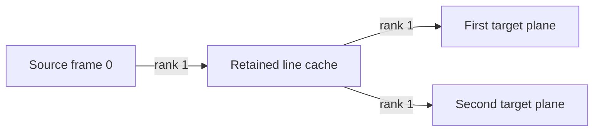

# Gaussian Cache Reuse for Cross Frame ADDs and Paid History

Several required reads of the same logical snapshot can share a transformed
owned copy. A small exact example replaces **two rank-2 Gaussian jobs by three
rank-1 jobs**, with no new productive-output credit. The tree, word skeleton
and moment prediction were frozen before exact Clifford realization and
all-column verification. The same geometry extends
Matarener's selected-center lower bound to non-nested Clifford transports and
typed-copy trees: **each of the 16 block-orientations still costs at least one
rank-8 job** under the original common-contact constraints.

These are a reusable construction and a scoped lower-bound proof, with exact
finite checks. They do not install a changed selected caller or establish a new
κ. Canonical source baseline: `ec2780e8aeb1c88acaf5e9e470ef8c68e7fbbb6c`,
selected conditional κ `0.00302015` from #4470.

## The small geometric law

A frame describes how a field is represented. Changing frames mixes some
number of independent binary directions; call that number the edge's rank.
A cache tree pays for each shared prefix once. The useful equations are

\[
\text{cache price at exponent }s=\sum_{e}r_e^s,\qquad s=1-\kappa,
\]

\[
\sum_e r_e\;\geq\;n-\dim\!\left(\bigcap_v\Lambda_v\right).
\]

Here each \(\Lambda_v\) is an n-dimensional Clifford chart. The second equation
says that the directions lost from the joint intersection must be paid for
somewhere in the tree. [PROOF.md](PROOF.md) gives the argument and the exact
chart convention. This is classical intersection geometry applied to the
repository's owned-copy and Gaussian-job contracts.

The simplest useful example has source frame 0 and two target planes
\(\langle1,2\rangle,\langle1,4\rangle\). Going separately costs \(2\,2^s\).
Sharing their line \(\langle1\rangle\) costs three rank-1 edges, hence 3.
The shared paid-transfer graph is:



The exact optimum over typed cache trees, even with arbitrary intermediate
Clifford charts, is

\[
\boxed{\min\{2\,2^s,3\}}.
\]

The preferred network changes at \(s=\log_2(3/2)\). Thus the geometry alone
does not predict the winner: the recursive exponent chooses the network.
At the selected exponent the shared tree saves
`0.9916351247756209043` moment units. **One additional rank-1 repair job
exhausts that saving.** [PLAN.json](PLAN.json) fixes the prediction and geometry
hash; [RESULT.json](RESULT.json) contains outward rational sign certificates.
This tests a predeclared module-cost prediction. The word skeleton was already
specified at the freeze; it is not a blind structural discovery or a held-out
κ improvement.

## Exact ownership and lifetime contract

Every cache in frame F contains \(C_F x\) for one specified logical snapshot x.
A COPY followed by the fully paid transport \(C_G C_F^{-1}\) creates a child
cache in G. Scalar ADDs consume it while leaving that cache unchanged. Its
productive-owner credit is zero.

| Module | Paid jobs | Ordinary whole-field passes | Extra fields |
| --- | --- | --- | --- |
| Two separate forward transfers | 2 H2 | 2 COPY, 2 ADD, 3 CLEAR | 1 owned |
| Shared forward fanout | 3 H1 | 3 COPY, 2 ADD, 5 CLEAR | 2 owned |
| Raw inverse-transpose gather | 3 H1 | 2 COPY, 3 ADD, 5 CLEAR | 2 owned |
| Caller supplies the line observation | 2 H1 marginal | 2 COPY, 2 ADD, 3 CLEAR | 1 owned, 1 borrowed observation |

Every paid move also retains its exact left and right monomial normalizers,
including phases; at most six such maps occur in each three-move module.
The table counts the explicit ordinary passes, not a complete bit, tape or
precision tariff. Those maps and passes remain implementation costs. Owned
fields may enter arbitrarily and are explicitly cleared; they leave zero.
Dirty borrowed workspace must be returned and cannot use this erasure rule.
Relative to separate transfers, sharing uses one more owned field, three more
explicit passes and one more pair of normalizers. A caller must price that
tradeoff before interpreting the recursive-moment gain as an algorithmic gain.

Reuse is valid when the required logical operator row equals the saved row,
or is a proved scalar multiple absorbed into the ADD coefficient. Matching
owner names or frame tags is insufficient. Intervening writes can invalidate
the snapshot; a later exact restoration can make it usable again. The checker
rejects a stale read and accepts restored and specified proportional rows.

The already-paid observation variant requires the caller to supply
\(Z=C_{\langle1\rangle}x\) for that exact snapshot. Z is returned unchanged.
Its creation, lifetime, hosting and eventual cleanup remain caller obligations.
This variant is derived after the frozen main prediction. It does not give an
independent observation for free.

## Where this changes the next research experiment

These are source-specific handoffs, not a new task allocation or priority revision.

1. **Batch cross-frame ADDs by exact snapshot.**
   [Discussion #5125](https://github.com/CrocSwap/integer-mult-bounds/discussions/5125)
   already implements a separate owned COPY, paid transport, ADD and CLEAR per
   split contact. That primitive is predecessor work. The changed experiment
   is to find several required reads of the *same operator row*, share their
   transformed prefix, and compare the complete changed invoice. Freeze the
   candidate tree, cache lifetime, normalizers and repair allowance before
   native lowering. Another frame seed does not test this premise.
2. **Use an actual paid-history observation as the root.**
   The paid-history continuation in
   [Discussion #4930](https://github.com/CrocSwap/integer-mult-bounds/discussions/4930)
   is already claimed. Supply this primitive to that question: first identify
   the exact saved helper/center expression and its later demand. Prove the
   row relation and return contract before claiming the marginal two-H1 bill.
   Retaining an observation can change the root geometry; a count of saved
   coordinates alone does not prove an independent Gaussian output block.
3. **Require a changed contact or payload before another center-only scan.**
   The new bound closes the non-nested-transport question explicitly left in
   [owned-centre-wire-floor](../owned-centre-wire-floor/README.md), and also
   covers typed-copy branching under those fixed caps. Arbitrary exact
   Clifford intermediate charts do not lower its eight-rank charge. Changed
   cross-frame contacts, helper boundaries, scalar graphs, or combinations of
   independent payloads require a new bound and remain outside this result.

The physical binding is the bottleneck: a candidate must supply the required
rows with a winning complete bill. The existing
[coded compiler reserve](../coded-compiler-closure/README.md) already supplies
conditional arithmetic for its declared model. More compiler digits do not
prove the missing physical caller. Likewise, the
[active-query bound](../coded-active-query-bound/README.md) and
[two-stage terminal result](../two-stage-coded-terminal/README.md) explain why
static mode counts and a free endpoint decoder are insufficient; neither is a
universal exclusion of paid-history or changed-contact constructions.

The submission refresh adds a concrete warning from
[active query feedback](../coded-active-feedback/README.md): its recovered
missing coefficient is accompanied by a nonzero second-input coefficient
whose rank fraction tends to 3/4. That scoped result does not reject other
feedback grammars, but makes the full row relation the first test for a
paid-history cache root. Recovering one desired coefficient is insufficient.

## Verification

From the repository root, with Python 3.12 and the standard library:

```sh
python3.12 -B scripts/research_package.py --package research/gaussian-cache-reuse --check-only
python3.12 -B scripts/research_package.py --package research/gaussian-cache-reuse
```

Both registered commands are read-only and compare every saved mathematical
field. They run normally and with `-O`; explicit failure checks remain active
with assertions disabled. The launcher supplies a fresh bytecode-cache namespace.

The exact dyadic-complex checker tests all 40 independent input columns in
each orientation, including arbitrary owned entry values; all 256 canonical
three-axis frame pairs, 140 non-nested; and wrong-phase, wrong-dual and stale
snapshot controls. It tests 6,750 two-qubit Lagrangian paths/trees and rebuilds
the original selected word's complete local paid profile and all 16 center
contact blocks. The general proofs are written, not proof-kernel checked.
The unchanged selected supplier's native, compiler and multiplication-theorem
obligations are not re-established by this module replay.

## Open next questions

- Which *actual* split-contact word contains a profitable repeated-snapshot
  cache tree? Start with one source row and its first two required cross-frame
  reads, including all intervening writes. The blockers are the exact row
  match, legal lifetime and complete bill; [TASK.json](TASK.json) records a
  bounded test.
- Can the claimed paid-history caller provide a retained observation with the
  required row relation and unchanged return? Start at its already claimed
  source helper prefix. The blocker is caller binding, rather than the local
  transport identity.
- Does changing a helper boundary or splitting a contact reduce the new joint
  intersection loss? Derive fresh Low/Up or replacement constraints for one
  changed block before extending a construction. The original caps cannot be
  reused after changing the graph.

## Provenance and credit

Prepared by zxv with substantial OpenAI Codex assistance. The predecessor
contributions used here are:

- **zxv:** the native and uniform supplier in
  [PR #4359](https://github.com/CrocSwap/integer-mult-bounds/pull/4359),
  logarithmic compiler in
  [PR #4411](https://github.com/CrocSwap/integer-mult-bounds/pull/4411), and
  higher-moment strictification and rational interval engine in
  [PR #4433](https://github.com/CrocSwap/integer-mult-bounds/pull/4433).
- **Matarener:** the owned-center intersection argument and fixed-word
  interval engine in
  [PR #5060](https://github.com/CrocSwap/integer-mult-bounds/pull/5060).
- **Dugongue:** the owned-C retiming contract in
  [PR #4534](https://github.com/CrocSwap/integer-mult-bounds/pull/4534).
- **Cinna Davis:** the selected word in
  [PR #4470](https://github.com/CrocSwap/integer-mult-bounds/pull/4470), building
  on [PR #4440](https://github.com/CrocSwap/integer-mult-bounds/pull/4440),
  [PR #4441](https://github.com/CrocSwap/integer-mult-bounds/pull/4441) and
  [PR #4447](https://github.com/CrocSwap/integer-mult-bounds/pull/4447).
  [PR #5220](https://github.com/CrocSwap/integer-mult-bounds/pull/5220)
  supplies the active-feedback application context and coupling warning.
- **Jacob Alan Sussman:** the mixed-target recursion in
  [PR #4268](https://github.com/CrocSwap/integer-mult-bounds/pull/4268).
- **icekylinx:** copied-center reuse in
  [PR #36](https://github.com/CrocSwap/integer-mult-bounds/pull/36) and the
  exact Clifford compiler lineage retained from
  [PR #531](https://github.com/CrocSwap/integer-mult-bounds/pull/531).
  See also the retained [copied-reversed attribution](../copied-reversed/README.md).
- **Tekalign:** the source-pinned T74 package in
  [PR #2768](https://github.com/CrocSwap/integer-mult-bounds/pull/2768), from
  which the unchanged exact Clifford kernel is loaded. Its retained notices
  preserve the complete native, phase and compiler contributor chain.

The live split-contact and paid-history discussions supply application context,
not mathematical inputs to the verifier. Metric geometry, memoization, Steiner
trees and subadditivity are classical; this package claims their explicit
costed application and scoped extension here. All retained source notices
and predecessor attribution remain in force.

Overlap checks on 2026-10-23 covered 347 PR records, 4,456 Discussion records
and 6,999 local package notes in the second bounded search. They do not cover
every diff, every comment or unpublished work. Live claims are provisional.
This contribution publishes author-checked evidence with its remaining
obligations explicit. Exact canonical source pins are in
[SOURCES.json](SOURCES.json). Apache-2.0.

The final upstream checkpoint is `ff3cc58e370d0f678e529246f8c73e8094e18fcf`.
Selection, catalogue, family guidance and every existing declared source pin
are unchanged. Newly archived two-axis and owned-kernel results concern
different contact alphabets; their source-only intake is not scientific
acceptance. The new active-feedback context above is pinned separately.
