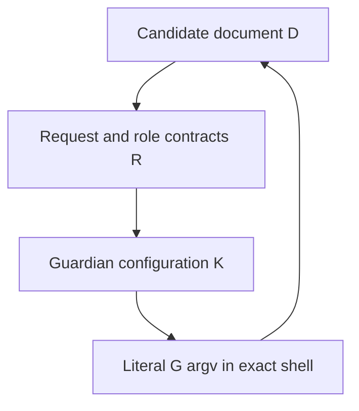
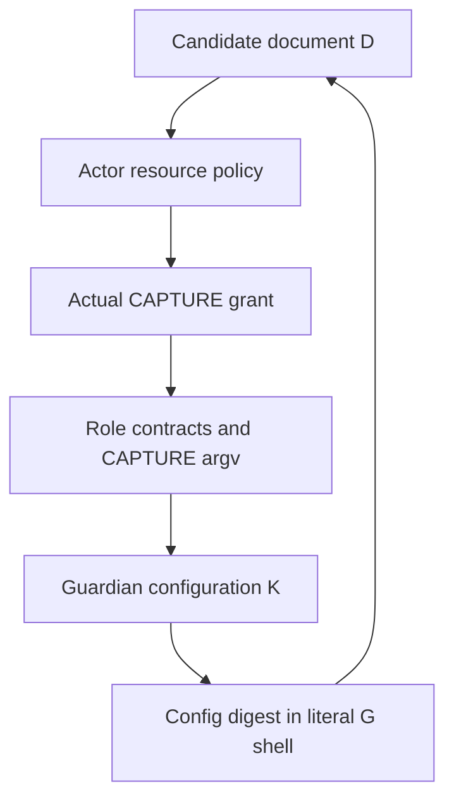

<!-- SPDX-License-Identifier: Apache-2.0 -->

# Independent review of S07.05 and the S07 source gate

## Review identity and fixed subject

This is a separate AI source review of the final combined source subject owned by [PR #6867](https://github.com/CrocSwap/integer-mult-bounds/pull/6867), exact commit `319ea1c5f4097ef87cc0b037327f26374e93e54d`. It is performed in the source-only round ending at 2026-11-08T06:38:54Z. No selected module was imported, no archived programme or control was executed, no archive was decompressed, and no native image, financial operation, scientific computation, or benchmark was launched. The review does not assert human, proof-kernel, or maintainer approval.

The reviewed definition is S07.05, “Obtain independent acceptance of the complete combined stage and installation order.” The separate full S07 gate is “Complete current combined stage, source bindings and caller assembly independently accepted.” This document distinguishes that complete source judgement from present execution eligibility. It does not issue an admission, an original financial grant, a compiler qualification, or an observation of successful CLOSE.

The immutable input selection comprises the 61 current source roles, seven profiles, 66 distinct mapped leaves plus the detached manifest, the two complete 197-member stage recipes, the exact current scientific drivers in their respective modes, and the inherited original helper/context and oracle contracts. The previous [S07.04 source reconciliation](https://github.com/Clear1nsight/integer-mult-bounds/blob/1144f0a715e84b3f08ebe7d0e8ed8a06543f2fad/research/h25-complete-source-binding-reconciliation/SOURCE-RECONCILIATION.md) is reused only within its explicitly accepted source scope. Its favourable verdict is not an axiom for this new review.

## Input availability and the original wording

The [original activity breakdown](https://github.com/Clear1nsight/integer-mult-bounds/blob/1ac58a84b725bd6f17eec66727edc877c49c7e66/research/h25-full-caller-readable-inputs/ACTIVITY-BREAKDOWN-v16.json) was inspected as text. Its S07.01 criterion is “Independently review the exact parent capture/launch source route.” Its status is historically complete, with additional contemporaneous remaining notes. Those notes concern their historical source selection and cannot be treated as current defects without tracing the successor. In particular, the historical CPC-B01 outer-actor callback objection has a concrete successor correction in the currently selected `inner_meter` source.

The activity methodology says that source tasks complete only their stated source scope, that activity scores do not complete their parent gate, and that they do not imply runtime or performance qualification. S10.05 separately asks to admit the complete source-bound caller and measurement/resource protocol for execution. These statements establish a real separation between complete source acceptance and admission of a particular execution.

The activity file identifies an original rubric at `control/hourly-progress/RUBRIC-v1.json`, SHA256 `9f987e10fc6a5027985741c2bf0e7a6e39a4103e6439e2321116034e8e4a4ea1`. Its 6,249-byte body was not read in this review. The available acquisition map supplies an archive object identity, not a separate readable leaf. The full S07 wording and its no-fractional-credit rule are also supplied verbatim in the present request, and those supplied definitions are used directly. No claim about other uninspected rubric clauses is made. The absence of that duplicate transport does not prevent a decision on the exact criterion expressly supplied here.

The earlier historical S07.01 review records are identified in v16, but their unexposed bodies are not inferred from their hashes. Instead, the current parent route was independently retraced below. Historical source acceptance and exact byte matching are used to delimit inherited contracts, not to bypass new reachability or ownership checks.

## Preserved parent route and S07.01 applicability

The actual parent spine is external original owner to native G, then M, K, P, and the in-place exec into C2. The following conclusions concern the actual reached constructors and methods, not merely role names.

| Edge and source anchor | Actual relation and preserved obligation |
| --- | --- |
| [`pre_m_entry.main`, lines 100-114](https://github.com/Clear1nsight/integer-mult-bounds/blob/319ea1c5f4097ef87cc0b037327f26374e93e54d/research/h25-retained-child-lock-repair/readable/implementation/bootstrap/pre_m_entry.py.txt#L100-L114) | The fixed bootstrap loads the selected private loader, requests role `M`, retains the actual bundle, binds its real guardian and source-private inner-meter module, and calls `run_nested`. The original GSTART pin comes from the runtime/manual record read by that loader. An argv digest cannot stand in for the actual owner. |
| [`private_loader.load_fixed`, lines 612-713](https://github.com/Clear1nsight/integer-mult-bounds/blob/319ea1c5f4097ef87cc0b037327f26374e93e54d/research/h25-retained-child-lock-repair/readable/implementation/bindings/private_loader.py.txt#L612-L713) | The one-use load latch precedes loading. The selected source, all seven profiles, and the control references are read through owned reads. The immutable role template is joined to actual GSTART and the exact current role runtime record. Runtime manual provenance and the source tuple are inserted by the fixed loader, rather than accepted as fields supplied by the template. Actual `sys.argv` must equal the resolved selected entry argv. |
| [`inner_meter._outer_actor_data` and `bind_outer_actor`, lines 331-418](https://github.com/Clear1nsight/integer-mult-bounds/blob/319ea1c5f4097ef87cc0b037327f26374e93e54d/research/h25-retained-child-lock-repair/readable/implementation/carrier/inner_meter.py.txt#L331-L418) | Exact built-in container and key validation precedes the schema/hash/copy operations in the outer-actor validator. Fixed depth, node, and scalar bounds, identity-only ancestry checks, and forbidden foreign values close the historical callback-shaped DATA hole on the reached path. `bind_nested_runtime` performs an earlier path lookup, so this is not a theorem about arbitrary hostile direct calls to that function. Its actual argument is produced by the fixed JSON/template constructor and is already plain DATA. |
| [`inner_meter.run_nested`, lines 488-669](https://github.com/Clear1nsight/integer-mult-bounds/blob/319ea1c5f4097ef87cc0b037327f26374e93e54d/research/h25-retained-child-lock-repair/readable/implementation/carrier/inner_meter.py.txt#L488-L669) | M checks the original source/grant/START correlation, persistent one-use marker, inherited launch and resource contract, and fixed K argv/cwd/environment. It reserves guardian spawn custody before the actual `Popen`, retains the real process object, waits for private registration, closes its writers, and retains failure uncertainty. Its diagnostic result does not claim a complete forest or whole physical-cost bound. |
| [`capture_entry.main`, lines 100-112](https://github.com/Clear1nsight/integer-mult-bounds/blob/319ea1c5f4097ef87cc0b037327f26374e93e54d/research/h25-retained-child-lock-repair/readable/implementation/bootstrap/capture_entry.py.txt#L100-L112) and [`capture.run`, lines 489-684](https://github.com/Clear1nsight/integer-mult-bounds/blob/319ea1c5f4097ef87cc0b037327f26374e93e54d/research/h25-retained-child-lock-repair/readable/implementation/carrier/capture.py.txt#L489-L684) | K binds actual C, F, and A module objects and the real guardian, then validates exact original manual provenance and actual inherited capture descriptors. Its publisher invocation precedes its fixed fee observation. It retains real child/process and capture ownership through terminal handling; publisher exec is accounted under the C2 role. Fee output remains provisional DATA, not formal CLOSE. |
| [`publisher.run`, lines 540-694](https://github.com/Clear1nsight/integer-mult-bounds/blob/319ea1c5f4097ef87cc0b037327f26374e93e54d/research/h25-retained-child-lock-repair/readable/implementation/controller/publisher.py.txt#L540-L694) | P obtains `open_owner` from the real A `bind_api` over the actual C and F modules and invokes it. It calls `ctx.begin` on the original request, publishes and rereads the exact new plan/admission/source-policy bytes while holding its real EX, then calls `release_for_exec`. The handoff is immutable permission/timing DATA, with `native_capability_transferred` false. P performs the selected `execve` into the fixed controller bootstrap. |
| [`active_current.bind_api`, lines 151-225](https://github.com/Clear1nsight/integer-mult-bounds/blob/319ea1c5f4097ef87cc0b037327f26374e93e54d/research/h25-retained-child-lock-repair/readable/implementation/controller/active_current.py.txt#L151-L225), [`open_owner`, lines 847-889](https://github.com/Clear1nsight/integer-mult-bounds/blob/319ea1c5f4097ef87cc0b037327f26374e93e54d/research/h25-retained-child-lock-repair/readable/implementation/controller/active_current.py.txt#L847-L889), and [`Context.adopt_handoff`, lines 743-765](https://github.com/Clear1nsight/integer-mult-bounds/blob/319ea1c5f4097ef87cc0b037327f26374e93e54d/research/h25-retained-child-lock-repair/readable/implementation/controller/active_current.py.txt#L743-L765) | A captures the actual module namespaces, class and function images, original lock/domain/control values, and current error containers. It constructs a private Context through its sentinel, records custody before acquiring the genuine original EX, invokes the actual original lease constructor/acquire methods, and checks its held instance. C2 acquires its own real owner and then adopts the same original handoff/request/HEAD. Copied Context-shaped DATA is never an alternative constructor. |
| [`retention_guardian.main`, lines 615-699](https://github.com/Clear1nsight/integer-mult-bounds/blob/319ea1c5f4097ef87cc0b037327f26374e93e54d/research/h25-retained-child-lock-repair/readable/implementation/native/retention_guardian.c.txt#L615-L699) | Native G owns whole-domain setup, role registration, dispatch, final retirement, and domain-empty observation under the original native contract. Its own pre-entry and terminal observation remain externally owned. Its source record is not a witness of its own final process exit. |

The currently selected capture, A, F, and inner-meter leaf identities match their corresponding #6830 subjects exactly. Their current SHA256 values are respectively `2d1faac28767b7c2530bbe5bd47dcf7b329ece8d80aafaef26dd81034c3d25b8`, `e94ee23f4f66b16f9d5a0b7f1cc510952d1769247283062d9124737d7838ce3c`, `164468176d2094fbd496eecfd0d0adf3b6ceaf89b2573456509157cc26256677`, and `0425efcc1ca6faa7ac44c4746087db6283650f5c2fefa6dab46581d4d8846c3d`. The changed fixed bootstrap paths and selected publisher are independently followed above. Their equality to an old body is not assumed from near-equal byte counts.

This re-establishes the current source applicability of the original parent-route acceptance. It does not assert that old runtime admissions, old publisher data, or an old resource judgement automatically authorise this successor.

## Interior construction order and the external installation obligation

The following is the interior constructor order once genuine original inputs have already been supplied. It is not yet an acyclic construction of those inputs and the original exact command together. The final challenge below identifies the missing external back-edge that the initial declared DAG did not represent.

1. Fix the owning source leaves and their semantic contracts, including the complete scientific bodies, original oracles, selected cache helpers, native source, retention owners, and exact fixed bootstraps. Resolve aliases to the same leaf identity. The root/native/interpreter association is an original operating-contract premise, not obtained by hashing source.
2. Construct the two complete stage recipes and the exact command inverses from those leaves. The normal and optimised drivers are distinct selections. Fix their profile and selected-packet references, then form the detached manifest. Those static objects do not embed future runtime GSTART or financial Context instances.
3. Independently accept that static subject, its universal constructor relation, and its installation order. A source review can name the input/output relation of a constructor before any particular runtime output exists. This review must not manufacture an execution grant or a complete physical-cost conclusion.
4. Obtain the genuine original issued inputs, in their existing ownership system. They include the original request and candidate document, opening/adoption evidence and expected HEAD, complete plan and command/resource admission, source/resource/current profiles, separately reviewed whole-body bill, complete-work review, selected packet, compiler/native association and currentness references, genuine grant pins, and original manual registration. Any later resource or authority judgement must be issued by its actual owner and have its own scope. The current source decision is not a substitute for those facts.
5. Invoke the already-selected pure `role_contracts.construct` over the fixed manifest/tuple and those genuine inputs. Freeze the resulting four role templates. They contain literal placeholder tokens for the future contracts digest, rather than embedding a hash of themselves. Hash the final role-contract bytes only after the bytes exist.
6. Invoke `guardian_config` with that contracts pin and the prior original manual record. Resolve all entry tokens now, and freeze the final configuration. The original outer launcher subsequently selects the exact configuration/source/grant pins in native G argv, with the fixed original cwd/environment and capture ownership. Nothing in an earlier original grant is required by the selected schema to embed this future final-configuration digest.
7. Only an actually admitted launch may generate fresh native START and registration records. The runtime loader reads these fixed records, checks the original request and deadline correlations, injects them into the role contracts, and creates the actual private modules/guardian association. Genuine lease acquisition and the caller/retention instances occur along that reached source path. Their material existence is a later runtime fact.
8. At termination, original externally owned capture/exit observation and any formal financial closure remain separate owner operations. No source certificate, P handoff, C2 observational result, borrower result, or G provisional record is promoted into an already completed CLOSE.

The decisive implementation edges are [`entry_argv`, lines 70-82](https://github.com/Clear1nsight/integer-mult-bounds/blob/319ea1c5f4097ef87cc0b037327f26374e93e54d/research/h25-retained-child-lock-repair/readable/implementation/bindings/role_contracts.py.txt#L70-L82), [`construct`, lines 257-349](https://github.com/Clear1nsight/integer-mult-bounds/blob/319ea1c5f4097ef87cc0b037327f26374e93e54d/research/h25-retained-child-lock-repair/readable/implementation/bindings/role_contracts.py.txt#L257-L349), and [`guardian_config`, lines 352-393](https://github.com/Clear1nsight/integer-mult-bounds/blob/319ea1c5f4097ef87cc0b037327f26374e93e54d/research/h25-retained-child-lock-repair/readable/implementation/bindings/role_contracts.py.txt#L352-L393). The actual loader's construction/readback body is [`derive_fixed_role_data`, lines 262-330](https://github.com/Clear1nsight/integer-mult-bounds/blob/319ea1c5f4097ef87cc0b037327f26374e93e54d/research/h25-retained-child-lock-repair/readable/implementation/bindings/private_loader.py.txt#L262-L330).

The local placeholder mechanism removes a direct role-template self-hash. The selected native grant also has an exact 18-key schema with no final configuration or contracts digest. Native G checks its source, probe, policy, reservation, and complete-delivery fields in [`validate_config_and_grant`, lines 270-295](https://github.com/Clear1nsight/integer-mult-bounds/blob/319ea1c5f4097ef87cc0b037327f26374e93e54d/research/h25-retained-child-lock-repair/readable/implementation/native/retention_guardian.c.txt#L270-L295). Those two observations are necessary but insufficient for complete acyclicity. The original candidate document and resource policy create additional content dependencies outside that local template calculation. Authority must also flow from the separately authenticated original caller and real EX/guardian constructors to consumers. A source hash, role string, JSON approval field, or review document does not create that authority.

The original `complete_work_review_pin` and `admission_pin` are particularly important external nodes. [`publisher.admission_check`, lines 515-538](https://github.com/Clear1nsight/integer-mult-bounds/blob/319ea1c5f4097ef87cc0b037327f26374e93e54d/research/h25-retained-child-lock-repair/readable/implementation/controller/publisher.py.txt#L515-L538) requires the original resource/funding and actual command-admission correlations. [`C.complete_bill`, lines 1070-1108](https://github.com/Clear1nsight/integer-mult-bounds/blob/319ea1c5f4097ef87cc0b037327f26374e93e54d/research/h25-retained-child-lock-repair/readable/implementation/controller/composed_controller.py.txt#L1070-L1108) and [`run_composed`, lines 1380-1420](https://github.com/Clear1nsight/integer-mult-bounds/blob/319ea1c5f4097ef87cc0b037327f26374e93e54d/research/h25-retained-child-lock-repair/readable/implementation/controller/composed_controller.py.txt#L1380-L1420) reread and bind those objects. The proof of a source-stage installation order does not supply their future numeric bill or execution permission.

The historical `successor_accepted: false` fields in selected profiles are inert source/provenance fields. They are not an authority mechanism read as a live acceptance latch on the reached path. New acceptance belongs in a separately published exact-subject review. Editing those frozen profiles merely to display a new verdict would change their identities and force dependent repinning, without supplying authority.

## Error, retirement, and mode discriminators

The decisive current group and enclosing-lock repairs are implemented. The review does not repeat the historical claim that they remain unimplemented. In [`run_group_capture`, lines 234-368](https://github.com/Clear1nsight/integer-mult-bounds/blob/319ea1c5f4097ef87cc0b037327f26374e93e54d/research/h25-retained-child-lock-repair/readable/implementation/source/run_guarded_v3.py.txt#L234-L368), a successful non-consuming `waitid` observation establishes custody of the actual unreaped direct child; the selected fresh-exec, default-SIGCHLD, no-auto-reap and exclusive-consuming-wait premises are essential. The source signals the process group while that identity is retained, then makes the single consuming `Popen.wait` call and performs no later numeric signal. It retains actual process and error objects and reserves separate body/signal/wait/stream-close slots before fallible work. An integer returned by an unrelated wait, or a reconstructed PID, would not prove this relation.

[`main`, lines 371-590](https://github.com/Clear1nsight/integer-mult-bounds/blob/319ea1c5f4097ef87cc0b037327f26374e93e54d/research/h25-retained-child-lock-repair/readable/implementation/source/run_guarded_v3.py.txt#L371-L590) separately preserves the working error and lock-close error, retires the actual owned lock once, raises the primary retained error first, and delays administrative `SystemExit(1)` until successful lock retirement. The actual queue [`main`, lines 188-297](https://github.com/Clear1nsight/integer-mult-bounds/blob/319ea1c5f4097ef87cc0b037327f26374e93e54d/research/h25-retained-child-lock-repair/readable/implementation/source/composed_queue.py.txt#L188-L297) requires both the expected mode-specific return code and empty runner stderr, then invokes the reached transport validator. Its older local validator is not the reached complete-stage inverse.

This is a local identity and error-order result, not proof of local wait completion after failed signalling, process-forest emptiness, durable custody after runner death, or measured resource fit. Whole-domain supervision and the original outer deadline remain necessary. Retention's borrower pending result and independent parent full readback remain distinct obligations, and the formal original financial CLOSE remains beyond the current observational return contract.

Any complete acceptance must preserve the following non-interchangeable discriminators without rerunning old controls in this source-only round.

* Genuine source-bound factory invocation and actual Context/EX identity cannot be replaced by copied configuration or a callback-shaped marker.
* The normal and optimised scientific drivers, original assertion/refusal order, actual Root, and reached waiting entry cannot be replaced by a legacy finite adapter or a common-driver assumption.
* The property-query owner is the distinct source-owned supervisor/observer path, and a consumed launch token cannot be replayed into another launch.
* A primary working exception must remain primary if lock close or later cleanup also fails.
* A child-side pending retention observation cannot replace full independent parent archive/restore readback.
* Instrumented diagnostic `full:baseline` cannot replace the original primary baseline sample or change original B,C first-pair order and later-pilot trigger.
* Provisional parent/fee/native observations and STOP/UNKNOWN handling cannot replace the separate successful original CLOSE owner.

## Why prospective premises do not make the source decision partial

The theorem remains

\[
\forall c\in C\;\forall E\in D_\sigma,\qquad
T_1(E)\land T_2(E)\land F_\sigma(E,c)
\Longrightarrow O_C(P,E,c)=_{\mathrm{original}}O_C(V(P),E,c).
\]

The original contexts, CP01-CP15, 52 helper identities, 65 contexts, independent oracles, and original observation projection are fixed. Both sides use the same originally qualified patched compiler/native subject. The factual antecedents concern actual source/private-module identities, genuine native/image/primitive association, original owners and no-change intervals, configured inputs, permitted environment class, actual one-use state, and the specified reached source construction. They cannot include the desired equality, a generic “harmlessness” claim, or an assumption that an unexamined constructor is correct.

A complete source proof with those original antecedents is a complete proof of the original prospective proposition. It is not an unfinished proof merely because its proposition has an antecedent. Conversely, an unresolved source edge, unreviewed changed constructor, missing relevant leaf, or “accept once a later repair is correct” condition would make the acceptance incomplete and would earn no full-gate credit. This review applies that distinction literally.

No target execution was requested as a proof obligation of S07.05. The independent review is completed here, while the installation construction remains open for the precise original-command edge identified below. Future target work remains unexecuted, and earns no credit in its own execution gates. Reading “unexecuted” to forbid all source acceptance before target execution would import the separate S10.05 gate into S07 and contradict v16's explicit source-scope rule. Reading complete source acceptance as automatically granting runtime execution would make the opposite error.

The full S07 gate must therefore be checked as its own conjunction on one exact subject. It requires a complete current combined stage, actual source bindings and caller assembly, and independent acceptance of that whole. It does not follow by counting completed small activities. The all-six compatibility proof, actual-consumer proof, current parent-route proof, audited whole binding relation, and the acyclic installation relation have to compose without a new hidden premise or a mode/identity substitution.

## Changes that invalidate the accepted internal lemmas

The judgement does not survive a changed owning leaf, compiler/native subject, stage member or command selection, mode-specific driver, helper/context selection, oracle, profile, detached manifest, constructor schema, runtime authority route, original observation projection, or error/cleanup order without a corresponding review. It also does not survive treating a historical review/control/provenance record as a current live grant, removing one-use or actual-owner checks, changing fixed paths/cwd/argv without repinning their consumers, supplying a different baseline protocol, or silently adopting the separate successful-CLOSE graph.

A new genuine runtime instantiation of the same reviewed constructor relation is not itself a changed source subject. It still requires all original runtime qualifications and separately issued permissions. An invalid or absent runtime input causes the selected consumers to reject or preserve uncertainty under their existing contract; it does not turn arbitrary DATA into an owner.

## Decisive original-command back-edge

The final review did find a consequential obstruction to the proposed complete installation argument. The local placeholder and grant-schema reasoning above does not establish the order of the original candidate document itself.

[`F.opening_evidence`, lines 466-490](https://github.com/Clear1nsight/integer-mult-bounds/blob/319ea1c5f4097ef87cc0b037327f26374e93e54d/research/h25-retained-child-lock-repair/readable/implementation/controller/funding_current.py.txt#L466-L490) retains two distinct identities. The candidate document's SHA256 is the registered command identity, while the candidate's literal `exact_shell_command` has its own separately checked shell SHA256. The native request/result must remain associated with that same candidate. The source does not permit replacing the original command identity with a convenient unrelated token.

Let `D` be the original candidate document, `d = SHA256(D)`, `R` the canonical role-contract bytes, `K` the canonical final guardian configuration, and `s` the exact shell command. Current `construct` requires `request.command_sha256 == candidate_document_pin.sha256` and embeds that request in the role contracts. `guardian_config` embeds the same original request and candidate digest and resolves the role-contract hash into role argv. Native G then requires the actual configuration digest in its own launch argv. If `s` is the direct literal G launch containing that final digest, the required content dependencies are

The first construction counterexample is to freeze `D0`, derive `R0` and `K0`, and only then rewrite `D0.exact_shell_command` with the newly determined `SHA256(K0)`. Changing the literal shell changes the candidate bytes. The once-through construction does not establish preservation of its already registered digest or a self-consistent new solution of all the resulting digest equations. Repeating the derivation is not a topological installation order. No collision-freedom axiom or impossibility of a coincidentally self-consistent digest is being proved. This is a dependency-order counterexample, not a target execution failure.

A second source-enforced cycle survives removal of the final configuration's direct candidate field. [`publisher.run`, lines 592-605](https://github.com/Clear1nsight/integer-mult-bounds/blob/319ea1c5f4097ef87cc0b037327f26374e93e54d/research/h25-retained-child-lock-repair/readable/implementation/controller/publisher.py.txt#L592-L605) checks the actor resource policy's `command_sha256` against the candidate document digest. [`capture.run`, lines 550-567](https://github.com/Clear1nsight/integer-mult-bounds/blob/319ea1c5f4097ef87cc0b037327f26374e93e54d/research/h25-retained-child-lock-repair/readable/implementation/carrier/capture.py.txt#L550-L567) independently reads the genuine CAPTURE grant and requires its `candidate_document_sha256` and `resource_policy_sha256` to equal that actual actor contract's candidate and policy pins. The actor contracts for CAPTURE and PUBLISHER are constructed from the same `original.pins`. [`construct`, lines 309-347](https://github.com/Clear1nsight/integer-mult-bounds/blob/319ea1c5f4097ef87cc0b037327f26374e93e54d/research/h25-retained-child-lock-repair/readable/implementation/bindings/role_contracts.py.txt#L309-L347) also substitutes the actual `capture_actual_grant_pin.sha256` into CAPTURE's entry argv and retains it in the canonical role-contract bytes. [`guardian_config`, lines 376-393](https://github.com/Clear1nsight/integer-mult-bounds/blob/319ea1c5f4097ef87cc0b037327f26374e93e54d/research/h25-retained-child-lock-repair/readable/implementation/bindings/role_contracts.py.txt#L376-L393) carries that exact argv into `role_argv.K`. The resulting configuration digest is required by direct literal G launch. The secondary dependency is therefore

The outer native G grant is a different checked relation. Its policy digest is compared with `config.outer_actor.resource_policy_pin`, whereas the publisher and CAPTURE actor contract use `original.pins.resource_policy_pin`. No reached equality between these two policy pins was established in this bounded review, so the secondary argument does not infer equality from their field names. An additional outer-grant cycle would follow for a specifically authenticated common-policy selection, but is not needed for this source-enforced CAPTURE route.

Deleting a config field, weakening a hash comparison, or inventing an unrelated command identifier would not close the unchanged contract. The proof also does not assert that a SHA256 fixed point is mathematically impossible. It establishes that the proposed acyclic construction has a real backwards edge and supplies no bounded construction of such a fixed point. Iterative rehashing is not an accepted installation order.

Nor is this a theorem that every allowed exact shell command must be cyclic. F requires a genuine exact shell string, but the inspected F schema does not itself require that string to contain the final G argv literally. An existing authenticated original external entry owner could provide a non-self-referential late parameter transport. The missing fact is the actual source and original contract of that owner, not a speculative prohibition of all such designs.

The bounded lookup did not locate such an owner in the supplied final subject or its inspected original dependency references. The selected [`external/envelope.py`](https://github.com/Clear1nsight/integer-mult-bounds/blob/319ea1c5f4097ef87cc0b037327f26374e93e54d/research/h25-retained-child-lock-repair/external/envelope.py.txt#L79-L85) permits the older `run_build_log_queue.py`, `run_queue3_subreaper.py`, and `run_queue4_subreaper.py` entries; it neither launches G nor calls `derive_fixed_role_data`. The [#6818 external-input inventory](https://github.com/Clear1nsight/integer-mult-bounds/blob/1479ccf2ec0bc29b7bf741a2d613d79e1f9ec19e/research/h25-original-refusal-repair/EXTERNAL-INPUTS.json) preserves the same inner graph and an external-input inventory, not a top-level G launcher. The original [`fixed_role_entry` retained in #6709](https://github.com/Clear1nsight/integer-mult-bounds/blob/24417a34746985dd110d70a42b2b863b96963c12/research/h25-manual-meter-integration/reference/areas/composed-fixed-role-entry-v1/fixed_role_entry.py.txt) authenticates the publisher and controller entries. Its separately retained [original parent evidence writer](https://github.com/Clear1nsight/integer-mult-bounds/blob/24417a34746985dd110d70a42b2b863b96963c12/research/h25-manual-meter-integration/reference/areas/fresh-round-financial-version-bindings-v1/original_records.py.txt) expressly performs no Tool/native launch and checks that the native request's `cmd` equals the COMMAND's exact shell string. That different financial namespace cannot be used as a substitute for the current original entry/CLOSE contract. No unavailable external source body is represented as inspected.

The precise missing essential input is the original externally owned candidate-document/native-G entry constructor and its authenticated runtime-parameter transport contract. It must explain how the genuine exact shell identity is frozen, how the final role/config/grant pins are later authenticated, and how their actual native argv remains the same originally reserved operation. Its absence blocks complete S07.05 installation acceptance and the full S07 source-stage gate. It does not erase the current internal parent route, all-six byte freeze, or reached cache/retention consumer theorem under the original genuine-entry premise.

## Shortest coherent integrated closing route

The closing correction belongs in that actual original entry owner. It must reuse the existing `private_loader.derive_fixed_role_data`, `role_contracts.construct`, and `guardian_config`, and the original owner's publication, native-call, capture, and error custody. A new unauthenticated shell reader, publisher, or detached helper is not a closing correction.

The required construction has the following exact dependency cuts.

1. Freeze and authenticate the original entry owner's source and its original fixed invocation form before producing the candidate document. That invocation form must not contain a digest of candidate-dependent role/config/grant bytes. Whether the existing owner already supports this separation must be established from its actual source and original interface, rather than added to T1 as an assumption.
2. Freeze the exact candidate document and its exact shell string, and retain their distinct hashes. Use the unchanged original pre-entry/one-use registration and reservation. Issue the original policy, grants, admission, and other role inputs against that same candidate identity. No repeated alias, smaller reservation, or new permission model is introduced.
3. Through the existing original owner's authenticated runtime-input channel, supply the actual original inputs to the already selected private-loader derivation. Check the selected loader/constructor code, module, globals, defaults, closures, and expected source identities before the call. A path read followed by hashing its own bytes is not that authentication. The real original owner must establish the input identities and the same original request before any derived source is consumed.
4. Retain the actual returned canonical role and configuration bytes and their pins. Publish them through the original owner's known-handle, exclusive-write, immutable-readback path, with the final original file modes and full bytes checked. Nothing in the candidate document is rewritten after its original registration. Only the authenticated later entry instance consumes the resulting pins.
5. Construct final G argv from those actual returned pins and the genuine original grants, then authenticate its exact cwd, environment, loaded native image/source association, capture endpoints, descriptor census, and selected source tuple. The original entry owner must own the actual launch/exec and terminal observation. The fixed native G argument schema, current GSTART/manual correlations, and downstream loader checks remain intact.
6. Retain all derivation, publication, capture, exec, wait, and cleanup failures in the original owner's error graph. Record pending acquisition/spawn before fallible native calls; close each known handle once; preserve the primary working error if close also fails; do not fabricate GSTART when entry fails before G. No unresolved publication or native birth may become a normal success or an automatic retry. G's fixed fresh capture constraints must still hold at its actual entry.
7. Charge any added entry derivation/publication/cleanup and native tail to the unchanged original complete work/resource interface. No numerical fit, free preparation, extra policy balance, or zero physical cost follows. Any need to alter the original clock/ownership scope, command protocol, native parameter interface, or financial schema must be raised explicitly as an amendment and cannot be silently adopted by this source review.

The dependent repinning order is the actual original entry owner first, then its authenticated loader/derivation and publication/call sites if changed, their literal child/source pins and alias joins, both complete recipes and command inverses where affected, profiles and selected packet, and the detached manifest. A separately frozen source review can then approve that final static tuple. Genuine original issued inputs follow their actual owner order, role bytes precede configuration bytes, and authenticated final native argv follows both. The candidate identity remains fixed throughout. All original parent handoff, full scientific and refusal paths, registry seal, borrower/parent readback, and external terminal owners must be rejoined after the changed entry. If the actual original interface already supplies this relation, only the missing exact-source proof is needed; otherwise an integrated change to that owner and its complete dependent closure is needed.

This is a complete specification of the missing source cut and the smallest credible integrated route. It is not a claim that the absent original owner was patched, that a future parameter transport is already authenticated, or that a protocol amendment has been authorised. Supplying surrogate executable code without that owner would recreate the isolated-helper error the task forbids.

## Final independent decision

I inspected the complete companion S07.02 and S07.03 arguments, their exact selected subject, the original criteria, the current parent source route, the actual retention parent readback and tool-cache checks, the controller finaliser, and the proposed shared DAG. The A/B source judgements are supportable within their expressly delimited literal scopes. Their revisions correctly preserve CP02's genuine primary transfer as a mandatory later comparison obligation and do not claim that the current candidate already implements or reaches that transfer.

The initial DAG's material/source-record distinction and its missing source-review/source-profile prerequisites were corrected. Those metadata corrections were necessary, but they do not remove the two original-command cycles above. A rank check over the declared 22 nodes and 33 forward edges cannot prove acyclicity of omitted content edges.

**S07.05 is not accepted for the claimed complete original installation order in this bounded review. The separate full S07 source gate is not accepted.** This is a binary failure to close those criteria, with no fractional full-gate credit. The reason is the concrete unresolved original exact-command/input construction, not the absence of target execution, native resource observations, or future successful CLOSE. The original prospective theorem and the internal source decisions remain unchanged; they are not silently strengthened or weakened to evade this obstruction.

The decisive next source input is the actual original external entry owner and parameter-transport contract named above. The credible closing action is to prove or integrate that owner along the stated dependency and error-custody route, then obtain an exact final combined-stage acceptance. No new target budget, runtime authority, source-domain assumption, or unlimited consultation round is supplied.

Original source notices, original contributors' attribution, and Apache-2.0 and source-specific notices remain applicable. This document contains new AI source reasoning and references the unchanged public source bodies; it does not replace their authorship or licensing.
