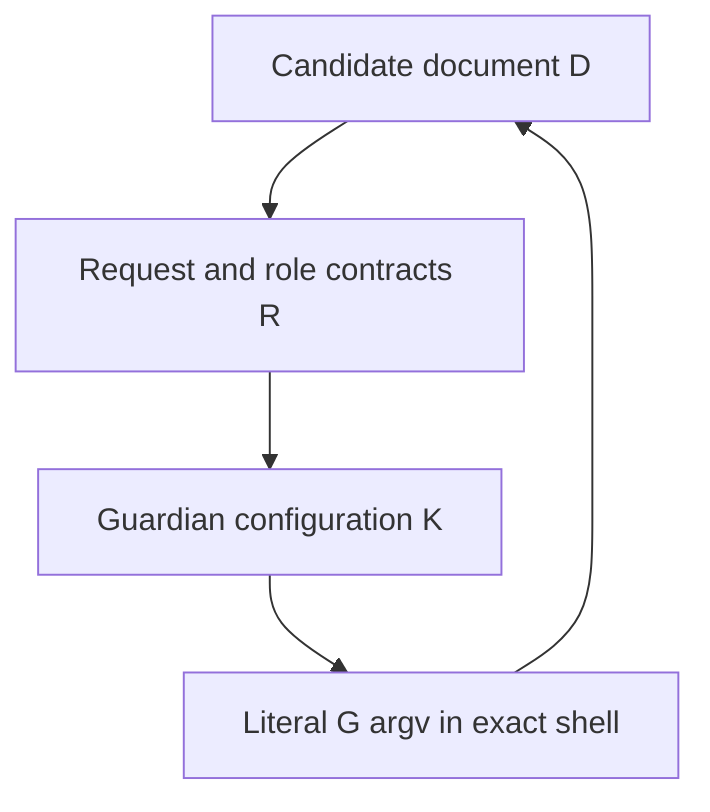
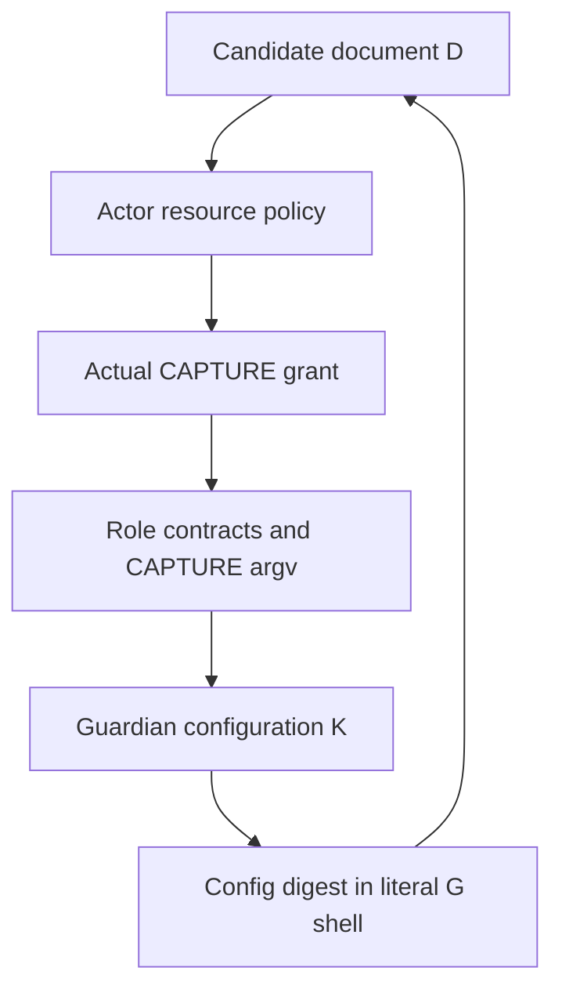

<!-- SPDX-License-Identifier: Apache-2.0 -->

# S07.05 installation-order obstruction and integrated closing construction

## Decision and exact subject

**S07.05 remains OPEN, and the separate full S07 source gate is NOT ACCEPTED.** The unchanged criterion is “Obtain independent acceptance of the complete combined stage and installation order.” The complete candidate is still the exact #6867 subject at `319ea1c5f4097ef87cc0b037327f26374e93e54d`. This review found a source-level original-command back-edge in the proposed installation order, rather than a reason to demand target execution. It gives two concrete direct-literal countercycles and the shortest integrated closing route through the actual original external entry owner. The exact missing owner/interface prevents claiming a completed patch. No host installation, native association, financial permission, scientific run, primary comparison, or complete-outcome CLOSE is issued or asserted.

The decision preserves the separately completed [S07.02 all-six freeze](https://github.com/Clear1nsight/integer-mult-bounds/blob/b467aae70ef3b63ea3c56caa37dfeb8e9ad9eae1/research/h25-all-six-source-freeze/SOURCE-DECISION.md) and [S07.03 actual-consumer argument](https://github.com/Clear1nsight/integer-mult-bounds/blob/167b4f7babb00fff832114bc7cec25d3060b6b73/research/h25-genuine-consumer-source-binding/SOURCE-DECISION.md) within their stated source scopes, re-establishes current S07.01 parent-route applicability, and reuses the exact S07.04 reconciliation publicly retained at #6869, commit `1144f0a715e84b3f08ebe7d0e8ed8a06543f2fad`. It does not infer the full gate from activity counts or recent finite controls. The internal source, ownership, and constructor relations are real results. Complete external installation acceptance additionally requires an actual original exact-command construction that is not supplied by those internal lemmas.

The companion `FINAL-TUPLE-INSTALL-GRAPH.json` gives the exact subject, the interior source-preparation order, and the missing original-command dependencies. Its ranked interior graph cannot prove that the complete original graph is acyclic. The countercycles and external-entry obligation are explicit in this decision and its certificate. No invented runtime pin is supplied.

| Binding | Exact identity |
| --- | --- |
| Owning implementation | #6867 at `319ea1c5f4097ef87cc0b037327f26374e93e54d` |
| Detached manifest | 39,563 bytes, SHA256 `3742b1a7e83dddaed87ffd147a18c0002474aa0772174a9c5d4d01e9f5d17d6f` |
| Selected packet | 11,759 bytes, SHA256 `825cde45bcdd071de9e2b7533deff664bb50cd5bc8bb7beaeb58401d0daa0160` |
| Source map | 32,276 bytes, SHA256 `23835f65f47b8d3a3ae0c6a1dbda4b5bf8479bedfdab8f475c7ef490c43fb9d9` |
| S07.04 certificate | 1,201,989 bytes, SHA256 `1ed6b0e4775d8d21dacbade5536cfbf7464592edd81004395cb7b3817f22508a`, Git blob `09de85d72fc7ff9e8778811adf273e34d3d24e28` |
| Normal recipe | SHA256 `7d79f68c712015bf959e24c95f756373ce9d30fa967b5a0f09734a7df38cae4f` |
| Optimised recipe | SHA256 `5ca055ba74d0b92b7162a5e0d33f8b12593994724fb8cdc4e0200262607b952d` |

The source map has 61 roles, seven profiles, 66 distinct mapped leaves, and 44 historical control references. Each complete recipe has 197 members. The original accepted scientific interior retains 52 helper identities, 65 contexts, 528 overlay relations, and 100 original commands. These identities establish applicability; the actual semantic and ownership relations are proved separately.

Primary immutable references are the [current manifest][manifest], [source map][source-map], [published complete S07.04 argument][s0704], [published certificate][certificate], and [publication review scope][scope]. The large certificate was retrieved through its exact Git blob and its complete bytes, SHA256, and Git blob identity were recomputed. Its bytes equal the retained prior certificate. No missing leaf is inferred from a manifest.

## The original criterion and the distinct full S07 gate

The original activity is a source acceptance criterion. The [original checklist][checklist] names S07.02 through S07.05 separately and its [method][method] says that source tasks may complete only their stated source scope, while activity completion does not imply the parent gate or runtime/performance qualification.

The separate full S07 gate is **Complete current combined stage, source bindings and caller assembly independently accepted**. This document makes a separate negative completion judgement on that conjunction because the original external entry/installation relation is not closed. It does not deny the completed source activities or derive the full gate from their count.

The exact gate wording and its no-fractional-credit rule were supplied in the current assignment. The original `RUBRIC-v1.json` is identified by 6,249 bytes and SHA256 `9f987e10fc6a5027985741c2bf0e7a6e39a4103e6439e2321116034e8e4a4ea1` in the public source map, but its body was not retrieved or decompressed during this round. No additional unseen rubric clause is claimed. The separately readable activity methodology and the supplied literal gate determine the scope used here.

A complete accepted theorem with genuine original quantified premises is not an unfinished proof merely because the theorem has an implication. The accepted statement remains

\[
\forall c\in C\;\forall E\in D_\sigma:\quad
T1(E)\land T2(E)\land F_\sigma(E,c)
\Longrightarrow
O_C(P,E,c)=_{\mathrm{original}}O_C(V(P),E,c).
\]

No assertion that the current host satisfies the antecedent is made. No correctness-of-constructor or desired-equality assumption is inserted into that antecedent. The downstream constructors and reached consumers are proved from source in S07.03 under the original genuine-entry premise. That proposition is not a construction of the external original exact command and its authenticated parameters. The additional installation relation remains open for the concrete reason proved below. There is no fractional full-gate credit for this unresolved source edge. Runtime work required by later gates remains unperformed and receives no credit.

This interpretation preserves both scopes. A complete accepted source theorem and complete original installation relation could satisfy this literal source gate without current-host admission or a baseline run. Here the source-level installation proof itself is incomplete. Withholding this gate therefore does not import a runtime condition. Treating a genuine external entry as an unexplained correct-constructor premise would instead evade the exact source criterion.

## Complete-stage composition rather than automatic cross-credit

The all-six subject is the current complete candidate, not a future primary-comparison or successful-CLOSE graph. Its scientific construction, bounded logs, witness serialisation, evidence storage/restoration, cache validity, and repeated digest/rank handling retain their exact original scientific bodies, observations, and independently evaluated oracles. Automatic retention extends evidence storage and has its actual registry, issuer, borrower, full consumer, and parent-readback owners. The normal driver is `fa9f473320e9df3a2328bd8388f12eca4e7fc3eeed9289f7fdbf2eeb32a7452f`; optimised refusal uses `92b507a2667b0d0085f63fb35176167806272934fef8149da691043411c81db0`. Both are 104,276 bytes.

The actual staged Root is `f5a2d33f2b4d3651f214156a0e7094c2bb516ce2d5ab7698d18c11f98f35dee0`. The legacy finite adapter named `full_driver` is not the reached scientific body. At [Root `_entry`, lines 804-833][root-entry], authenticated provider and driver bytes feed a fresh scientific module, actual bootstrap capability/API, original argv, and actual optimisation. The new parents cross this boundary through argv, streams, environment, and the qualified filesystem view, not fabricated scientific Python owners.

The S07.02 proof establishes compatibility through common original scientific observations and ordered owner lifetimes. The S07.03 proof establishes downstream fresh construction, cache use, invalidation/fallback, the full original CLI, and terminal retention. S07.04 establishes current code/profile/command/native bindings. This review checks that these results name the same final tuple, and then challenges the additional original external installation relation. That additional relation has the obstruction below; it cannot be supplied by cross-credit from the internal results.

The scientific source lemma is inherited only for unchanged, exactly matched subjects and contracts. The current outer construction is not accepted merely because #6715 or #6830 used favourable labels. CP01-CP15, all helper/context identities, independent oracles, and primary/secondary error order remain fixed. No finite fixture, PASS marker, source count, historical anchor, or expected refusal supplies the original full positive oracle.

## Preserved S07.01 parent capture and launch route

S07.01 originally required independent review of the exact parent capture/launch source route. Its historical credit and historical CPC-B01 note are not enough to accept the current route. This review follows the current source.

The selected `pre_m_entry.main`, [lines 100-114][pre-m], receives the actual fixed `PrivateBundle`, binds its actual guardian, original START pin, selected outer source, role data, and capture argv into the selected inner meter, then calls `run_nested`. The private loader obtains role data by reading the exact immutable final contracts and actual native runtime records. Templates cannot contain or impersonate future runtime START or `source_pins`; these are added only after actual reads and equality checks at [loader lines 612-713][loader-runtime].

The old callback-boundary concern is addressed by `_outer_actor_data` and `bind_outer_actor` at [inner-meter lines 331-418][inner-data]. Exact built-in container and key types are checked before hashing, schema-set equality, or JSON copying; cycles are detected by identity. The actual `bind_nested_runtime` performs an earlier path read from `outer_actor`, so the proof is correctly scoped to its reached caller. That input comes from the fixed JSON contracts and the authenticated plain-data constructor. This does not assert safety for arbitrary external direct Python calls supplying hostile objects.

[`run_nested`, lines 488-669][inner-run], retains the genuine START/source/grant relation, persistent one-use marker, actual strongly held Popen child, captures, native generation, and consuming wait. Its observation explicitly does not claim that a direct-child wait proves full forest disposal. The selected native guardian is the separate owner of the domain and whole termination predicate. This preserves the original owner split instead of giving a nested meter authority over the complete operation.

At [publisher lines 566-575][publisher], the publisher calls `A.bind_api(C,F,role='PUBLISHER',...)`, calls the returned factory, and invokes the actual context's `begin` and `check`. It publishes and rereads the exact new plan/admission/source policy under its original EX. `release_for_exec` must actually return from known close, and all publisher handles must be known closed, before `os.execve` at lines 637-652. No descriptor or ownership object is serialised into the handoff. C2 then obtains a fresh actual factory-created context and adopts the exact pending metadata. The fixed guardian channel is the separate source-bound P-to-C2 exec continuation.

On failure, the publisher retains its primary and secondary errors and does not repeat a close already entered. The bootstrap retains cleanup ownership until C takes over; C then owns the finaliser and source-retention continuation. The current return contracts agree. C returns integer 0 or 1, the bootstrap consumes that integer, retention child success is pending parent readback, and G's output is provisional until externally observed completion. This supplies the current S07.01 applicability argument.

## Interior source preparation and the unresolved complete installation order

The graph separates fixed content from genuine external inputs and actual future runtime events. A rank strictly increases on the 33 declared forward edges of the initial 22-node interior graph. That arithmetic fact is correct but insufficient. It omitted dependencies of the original candidate document, exact shell string, and resource policy. The table records the useful interior order only; steps 7 to 10 cannot be promoted into a complete original construction until the external back-edge is resolved.

| Step | Object and existing owner | Prerequisites and resulting obligation |
| --- | --- | --- |
| 1 | Original scientific source and accepted contracts | Retain exact #6715/#6752 selections, context multiplicity, oracles, and original contract. Do not decode archives in this review or replace missing bodies with summaries |
| 2 | Owning Python/C/header/proof leaves | Freeze exact path, bytes, and declared mode. Changed child identities must reach the actual parent function literals and alias selections |
| 3 | Actual callers and both complete recipes | Freeze Root/provider/driver/waiting-entry/runner relations, each 197-member recipe, JOBS, queue case, native argv, and original cwd inverse |
| 4 | Seven profiles and selected packet | Freeze profiles and packet only after their source and command inputs. These contain no future detached-manifest or final role-contract hash |
| 5 | Detached manifest | Freeze current sources, profiles, argv shapes, and historical control references. The manifest does not contain its own digest |
| 6 | Independent review of fixed internal source | Retain the complete S07.02/S07.03 source results and the exact S07.04 reconciliation. These do not by themselves accept the complete original installation graph, and are not execution-admission, complete-work, funding, or environment-qualification records |
| 7 | Genuine original inputs | The original external owner supplies real TCB/currentness, native-image association, original plan/admission/opening/HEAD/manual records, resource bill/review, and actual grants. Their existence is not inferred here |
| 8 | Existing parent derivation | `private_loader.derive_fixed_role_data` reads exact sources/profiles and original issued records, loads the authenticated constructor, and derives ordinary role DATA |
| 9 | Final guardian configuration | After canonical contract bytes have a hash, `guardian_config` resolves exact source, loader, manifest, and contract tokens. Original grants precede this configuration |
| 10 | Final external native argv | The original external caller authenticates the completed configuration, actual native image/source, grant, and exact argv. It is not authorised by this source review |
| 11 | Actual G and actor startup, if later admitted | Real G START/domain/runtime records precede M, K, P, and C2. P performs known-close exec; C2 creates fresh EX and actual consumers |
| 12 | Actual case, seal, retention, and terminal tail | Property and scientific owners retire; G seals; one borrower archives/restores; parent full readback gates release; K/Fee/M/G and external completion owners finish their own scopes |

Source preparation fixes content and proof. Prospective installation describes how a separately authorised original owner can place and authenticate that content at its exact original paths and modes. Actual installation requires genuine ownership, filesystem identity, known closure, installed-image association, and currentness. None was performed here. A public `.txt` archive is not a portable installation or a set of local target attachments.

The actual derivation code at [loader lines 262-330][derive] reads the final manifest and already-issued original input records, invokes the exact selected `role_contracts.construct`, serialises its result, computes the resulting contract pin, and only then calls `guardian_config`. The constructor at [lines 257-349][construct] binds the compiler's native-subject reference to the original `operating_TCB_pin` and its interval reference to the original `current_profile_pin`. It requires exact original F opening, request, policy, role, and source relationships and creates no financial or native owner.

The entry templates at [role-contract lines 70-82][entry-template] contain literal placeholders, not their own future digest. Final `guardian_config`, [lines 352-393][guardian-config], resolves those placeholders after contracts are frozen. It rejects unresolved tokens. `load_fixed` later requires the actual resolved `sys.argv` to equal the selected role argv and joins actual G START/manual/runtime records.

The native G grant schema at [lines 270-295][g-grant] has eighteen keys and no final guardian-configuration or role-contract hash. That observation excludes one immediate self-hash, but does not prove complete acyclicity. Native G binds its own outer-actor policy pin; that pin is not proved equal to the separate actor policy solely by field name. The source-enforced second countercycle below uses the actual CAPTURE grant, its checked actor policy, and its digest in role argv, and survives deleting the configuration's direct candidate field. No grant comparison, original command identity, or protocol may be weakened to hide it.

The internal authority boundaries remain valid. Source bytes and role names do not create a grant. Pure constructors return DATA; A/F and G obtain their actual ownership and observations later. Neither G nor C can publish its own already-completed external terminal observation. The missing external parameter transport must preserve those boundaries and cannot be replaced by self-authenticated DATA. In particular, neither this decision nor the A/B source acceptances may be inserted as `complete_work_review_pin` or `admission_pin` with stronger resource/funding/permission meaning.

## Native, error, and terminal closure within the complete stage

The original theorem uses the same configured patched GCC/binutils subject on both sides, with original T1/T2 and concrete finite `F_sigma` facts. The current source does not accept an equality or harmlessness flag. The selected association derives independent metadata/backend/encoder commands and the actual configured/header/plugin/linker/input frontier, observes original readonly fallback paths, and reobserves currentness before consuming a one-use launch token. Current native source preserves the selected credential/DAC/topology, output metadata, fallback, stream, and terminal effects within explicit `D_sigma`. [Current preservation argument][preservation] and [substantive construction][native-proof].

Normal full execution and optimised original refusal remain separate command/receiver cases. Property queries occur only on the normal partition and retain their actual observer, syscall, stream, wait, EOF, and readback ownership. No current-host eligibility is inferred from the source proof or profile.

The common runner now retains direct-child identity using WNOWAIT, signals before its one consuming wait, and never signals afterwards. Preallocated errors keep body, signal, wait, and capture failures distinct. Main separately retains working and enclosing-lock-close failures, and delays administrative exit 1 until successful lock retirement. The queue requires expected exit code and empty stderr. These are actual current reached owners, not an isolated replacement helper. Their proof still uses fresh exec, default SIGCHLD/no auto-reap, exclusive consuming-wait ownership, and strong references. Failed signal does not establish local wait completion; the actual outer deadline/domain/guardian remains necessary. [Runner][runner] and [queue][queue].

After original scientific cleanup and late-last, the scientific owner performs only its permitted source-custody/receipt work. Administrative containment, source retention, and lease release remain distinct owned operations. C's finaliser invokes registry finishing and the production issuer before actual release. G's freeze-and-seal census accepts only the registered administrative M/K/C2 members with closed writers and no pending birth, and rejects live Root/B/PropertyQuery producers. The capability comes from this actual owner path, not an `all_process_groups_empty` JSON assertion. The real borrower runs full archive/restore/oracle work; its pending result cannot release the parent until fresh independent full readback. [G seal][g-seal], [issuer][issuer], and [parent authority][parent-authority].

Complete descendant emptiness remains unobserved in this source round. In-process error custody remains nondurable after runner death. Those limits are preserved, rather than silently converted into successful results. Within the reviewed internal retirement graph, the existing outer domain and actual terminal predicate retain their source owners. The separate external entry/installation obligation remains open as stated below.

## Decisive original-command back-edge

The final review did find a consequential obstruction to the proposed complete installation argument. The local placeholder and grant-schema reasoning above does not establish the order of the original candidate document itself.

[`F.opening_evidence`, lines 466-490](https://github.com/Clear1nsight/integer-mult-bounds/blob/319ea1c5f4097ef87cc0b037327f26374e93e54d/research/h25-retained-child-lock-repair/readable/implementation/controller/funding_current.py.txt#L466-L490) retains two distinct identities. The candidate document's SHA256 is the registered command identity, while the candidate's literal `exact_shell_command` has its own separately checked shell SHA256. The native request/result must remain associated with that same candidate. The source does not permit replacing the original command identity with a convenient unrelated token.

Let `D` be the original candidate document, `d = SHA256(D)`, `R` the canonical role-contract bytes, `K` the canonical final guardian configuration, and `s` the exact shell command. Current `construct` requires `request.command_sha256 == candidate_document_pin.sha256` and embeds that request in the role contracts. `guardian_config` embeds the same original request and candidate digest and resolves the role-contract hash into role argv. Native G then requires the actual configuration digest in its own launch argv. If `s` is the direct literal G launch containing that final digest, the required content dependencies are

The first construction counterexample is to freeze `D0`, derive `R0` and `K0`, and only then rewrite `D0.exact_shell_command` with the newly determined `SHA256(K0)`. Changing the literal shell changes the candidate bytes. The once-through construction does not establish preservation of its already registered digest or a self-consistent new solution of all the resulting digest equations. Repeating the derivation is not a topological installation order. No collision-freedom axiom or impossibility of a coincidentally self-consistent digest is being proved. This is a dependency-order counterexample, not a target execution failure.

A second source-enforced cycle survives removal of the final configuration's direct candidate field. [`publisher.run`, lines 592-605](https://github.com/Clear1nsight/integer-mult-bounds/blob/319ea1c5f4097ef87cc0b037327f26374e93e54d/research/h25-retained-child-lock-repair/readable/implementation/controller/publisher.py.txt#L592-L605) checks the actor resource policy's `command_sha256` against the candidate document digest. [`capture.run`, lines 550-567](https://github.com/Clear1nsight/integer-mult-bounds/blob/319ea1c5f4097ef87cc0b037327f26374e93e54d/research/h25-retained-child-lock-repair/readable/implementation/carrier/capture.py.txt#L550-L567) independently reads the genuine CAPTURE grant and requires its `candidate_document_sha256` and `resource_policy_sha256` to equal that actual actor contract's candidate and policy pins. The actor contracts for CAPTURE and PUBLISHER are constructed from the same `original.pins`. [`construct`, lines 309-347](https://github.com/Clear1nsight/integer-mult-bounds/blob/319ea1c5f4097ef87cc0b037327f26374e93e54d/research/h25-retained-child-lock-repair/readable/implementation/bindings/role_contracts.py.txt#L309-L347) also substitutes the actual `capture_actual_grant_pin.sha256` into CAPTURE's entry argv and retains it in the canonical role-contract bytes. [`guardian_config`, lines 376-393](https://github.com/Clear1nsight/integer-mult-bounds/blob/319ea1c5f4097ef87cc0b037327f26374e93e54d/research/h25-retained-child-lock-repair/readable/implementation/bindings/role_contracts.py.txt#L376-L393) carries that exact argv into `role_argv.K`. The resulting configuration digest is required by direct literal G launch. The secondary dependency is therefore

The outer native G grant is a different checked relation. Its policy digest is compared with `config.outer_actor.resource_policy_pin`, whereas the publisher and CAPTURE actor contract use `original.pins.resource_policy_pin`. No reached equality between these two policy pins was established in this bounded review, so the secondary argument does not infer equality from their field names. An additional outer-grant cycle would follow for a specifically authenticated common-policy selection, but is not needed for this source-enforced CAPTURE route.

Deleting a config field, weakening a hash comparison, or inventing an unrelated command identifier would not close the unchanged contract. The proof also does not assert that a SHA256 fixed point is mathematically impossible. It establishes that the proposed acyclic construction has a real backwards edge and supplies no bounded construction of such a fixed point. Iterative rehashing is not an accepted installation order.

Nor is this a theorem that every allowed exact shell command must be cyclic. F requires a genuine exact shell string, but the inspected F schema does not itself require that string to contain the final G argv literally. An existing authenticated original external entry owner could provide a non-self-referential late parameter transport. The missing fact is the actual source and original contract of that owner, not a speculative prohibition of all such designs.

The bounded lookup did not locate such an owner in the supplied final subject or its inspected original dependency references. The selected [`external/envelope.py`](https://github.com/Clear1nsight/integer-mult-bounds/blob/319ea1c5f4097ef87cc0b037327f26374e93e54d/research/h25-retained-child-lock-repair/external/envelope.py.txt#L79-L85) permits the older `run_build_log_queue.py`, `run_queue3_subreaper.py`, and `run_queue4_subreaper.py` entries; it neither launches G nor calls `derive_fixed_role_data`. The [#6818 external-input inventory](https://github.com/Clear1nsight/integer-mult-bounds/blob/1479ccf2ec0bc29b7bf741a2d613d79e1f9ec19e/research/h25-original-refusal-repair/EXTERNAL-INPUTS.json) preserves the same inner graph and an external-input inventory, not a top-level G launcher. The original [`fixed_role_entry` retained in #6709](https://github.com/Clear1nsight/integer-mult-bounds/blob/24417a34746985dd110d70a42b2b863b96963c12/research/h25-manual-meter-integration/reference/areas/composed-fixed-role-entry-v1/fixed_role_entry.py.txt) authenticates the publisher and controller entries. Its separately retained [original parent evidence writer](https://github.com/Clear1nsight/integer-mult-bounds/blob/24417a34746985dd110d70a42b2b863b96963c12/research/h25-manual-meter-integration/reference/areas/fresh-round-financial-version-bindings-v1/original_records.py.txt) expressly performs no Tool/native launch and checks that the native request's `cmd` equals the COMMAND's exact shell string. That different financial namespace cannot be used as a substitute for the current original entry/CLOSE contract. No unavailable external source body is represented as inspected.

The precise missing essential input is the original externally owned candidate-document/native-G entry constructor and its authenticated runtime-parameter transport contract. It must explain how the genuine exact shell identity is frozen, how the final role/config/grant pins are later authenticated, and how their actual native argv remains the same originally reserved operation. Its absence blocks complete S07.05 installation acceptance and the full S07 source-stage gate. It does not erase the current internal parent route, all-six byte freeze, or reached cache/retention consumer theorem under the original genuine-entry premise.

## Shortest coherent integrated closing route

The closing correction belongs in that actual original entry owner. It must reuse the existing `private_loader.derive_fixed_role_data`, `role_contracts.construct`, and `guardian_config`, and the original owner's publication, native-call, capture, and error custody. A new unauthenticated shell reader, publisher, or detached helper is not a closing correction.

The required construction has the following exact dependency cuts.

1. Freeze and authenticate the original entry owner's source and its original fixed invocation form before producing the candidate document. That invocation form must not contain a digest of candidate-dependent role/config/grant bytes. Whether the existing owner already supports this separation must be established from its actual source and original interface, rather than added to T1 as an assumption.
2. Freeze the exact candidate document and its exact shell string, and retain their distinct hashes. Use the unchanged original pre-entry/one-use registration and reservation. Issue the original policy, grants, admission, and other role inputs against that same candidate identity. No repeated alias, smaller reservation, or new permission model is introduced.
3. Through the existing original owner's authenticated runtime-input channel, supply the actual original inputs to the already selected private-loader derivation. Check the selected loader/constructor code, module, globals, defaults, closures, and expected source identities before the call. A path read followed by hashing its own bytes is not that authentication. The real original owner must establish the input identities and the same original request before any derived source is consumed.
4. Retain the actual returned canonical role and configuration bytes and their pins. Publish them through the original owner's known-handle, exclusive-write, immutable-readback path, with the final original file modes and full bytes checked. Nothing in the candidate document is rewritten after its original registration. Only the authenticated later entry instance consumes the resulting pins.
5. Construct final G argv from those actual returned pins and the genuine original grants, then authenticate its exact cwd, environment, loaded native image/source association, capture endpoints, descriptor census, and selected source tuple. The original entry owner must own the actual launch/exec and terminal observation. The fixed native G argument schema, current GSTART/manual correlations, and downstream loader checks remain intact.
6. Retain all derivation, publication, capture, exec, wait, and cleanup failures in the original owner's error graph. Record pending acquisition/spawn before fallible native calls; close each known handle once; preserve the primary working error if close also fails; do not fabricate GSTART when entry fails before G. No unresolved publication or native birth may become a normal success or an automatic retry. G's fixed fresh capture constraints must still hold at its actual entry.
7. Charge any added entry derivation/publication/cleanup and native tail to the unchanged original complete work/resource interface. No numerical fit, free preparation, extra policy balance, or zero physical cost follows. Any need to alter the original clock/ownership scope, command protocol, native parameter interface, or financial schema must be raised explicitly as an amendment and cannot be silently adopted by this source review.

The dependent repinning order is the actual original entry owner first, then its authenticated loader/derivation and publication/call sites if changed, their literal child/source pins and alias joins, both complete recipes and command inverses where affected, profiles and selected packet, and the detached manifest. A separately frozen source review can then approve that final static tuple. Genuine original issued inputs follow their actual owner order, role bytes precede configuration bytes, and authenticated final native argv follows both. The candidate identity remains fixed throughout. All original parent handoff, full scientific and refusal paths, registry seal, borrower/parent readback, and external terminal owners must be rejoined after the changed entry. If the actual original interface already supplies this relation, only the missing exact-source proof is needed; otherwise an integrated change to that owner and its complete dependent closure is needed.

This is a complete specification of the missing source cut and the smallest credible integrated route. It is not a claim that the absent original owner was patched, that a future parameter transport is already authenticated, or that a protocol amendment has been authorised. Supplying surrogate executable code without that owner would recreate the isolated-helper error the task forbids.

## Later graphs and invalidation

CP02 still requires separate fresh original baseline and candidate invocations and independent typed same-input transfer. This current candidate graph does not implement or reach the later primary transfer/comparison. The source decision preserves that obligation and supplies no comparison credit.

The current `full:baseline` image is an instrumented diagnostic. It is not original primary driver `5b963a5f108b334a627e68001c80b9843fb300c7394693e72f34ce0a6050e6f1`, and a historical anchor is not fresh primary transfer. Before any future comparison, the corrected #6847/#6837 owner and exact typed receiver must be adopted with the genuine shared UNKNOWN_OWNER, original subreaper, nine modules, and persistent reservations. Preserve B,C first-pair order and the original later-pilot trigger. This source decision neither implements that later graph nor retroactively turns a candidate observation into a comparison.

The current A retains STOP/UNKNOWN. Successful complete CLOSE requires #6762 through actual loader/bootstrap/role/profile/manifest consumers and a distinct closer after target end and independent outcome review. Adding that graph changes the source selection and requires its own exact reconciliation. No unauthenticated publisher or invented outcome is supplied.

The accepted internal lemmas are invalidated by a consequential source byte, path, mode, alias, profile, command, recipe, constructor, private import, default/closure, lifecycle, oracle, context, native/configured subject, domain, T1/T2, or resource-contract change. Any external-entry correction must be reconciled with their complete dependent closure. A later document may cite these exact results, but cannot silently widen them into complete installation or execution acceptance.

## Verification, credit, and open next questions

New work comprised passive public-source reading, complete certificate readback, JSON/byte/hash comparisons, source/contract proof, a concise rank check of the declared interior order, and a finite symbolic verification of the two closed dependency cycles. The interior check is not a full installation proof. No target module was imported, no target process inspected or launched, no native code compiled, no archive decoded/decompressed, and no old or new guarded suite executed. The exact publication readback is separate from this substantive source argument. Planning/onboarding checks, if hosted later, provide no scientific qualification.

The recorded guarded policy balance remains 23.109466521 seconds of the unchanged 2400-second cap. New guarded debit is zero. Preparation, Pro/review, reporting, publication, final metadata, and historical physical gaps remain OPEN_NOT_ZERO. No new budget, authority, protocol, premise, domain, or mathematical criterion has been adopted.

S07.02 and S07.03 have separate complete source decisions, and S07.04 remains the already accepted exact binding result. S07.05 and the full S07 source gate remain OPEN because of the unresolved original external entry construction. This is not fractional full-gate acceptance. Actual control/runtime qualification, complete comparison, successful financial CLOSE, and all other original overall milestones remain separate and open. No historical progress file, weight, denominator, selected frontier, or maintainer ledger is changed by this contribution.

The immediate missing source input is the actual original external candidate/native-G entry owner and its accepted parameter-transport interface. The integrated route above specifies what must be proved or changed there. Genuine environmental/native association, complete control/resource admission, primary comparison, and successful-CLOSE adoption remain later obligations. No automatically funded replay or extra source round is requested. Completed source decisions should be reused within their exact scope until a consequential invalidation occurs.

Prepared for Chris R / Clear1nsight with substantial OpenAI ChatGPT Pro and Codex assistance. The review is independently generated AI source analysis with a separate challenging reviewer and a root audit. It is not human review, proof-kernel verification, or maintainer approval. Existing Clear1nsight and original repository authors' implementation, source, proof, and licence notices remain intact. New prose and metadata are Apache-2.0. Predecessor and rejected/outside-work scopes remain those in the immutable [RELATED-WORK record][related].

[manifest]: https://github.com/Clear1nsight/integer-mult-bounds/blob/319ea1c5f4097ef87cc0b037327f26374e93e54d/research/h25-retained-child-lock-repair/readable/implementation/bindings/SOURCE-MANIFEST-v2.json.txt
[source-map]: https://github.com/Clear1nsight/integer-mult-bounds/blob/319ea1c5f4097ef87cc0b037327f26374e93e54d/research/h25-retained-child-lock-repair/SOURCE-MAP.json
[s0704]: https://github.com/Clear1nsight/integer-mult-bounds/blob/1144f0a715e84b3f08ebe7d0e8ed8a06543f2fad/research/h25-complete-source-binding-reconciliation/SOURCE-RECONCILIATION.md
[certificate]: https://github.com/Clear1nsight/integer-mult-bounds/blob/1144f0a715e84b3f08ebe7d0e8ed8a06543f2fad/research/h25-complete-source-binding-reconciliation/CERTIFICATE-v1.json
[scope]: https://github.com/Clear1nsight/integer-mult-bounds/blob/1144f0a715e84b3f08ebe7d0e8ed8a06543f2fad/research/h25-complete-source-binding-reconciliation/REVIEW-SCOPE.json
[checklist]: https://github.com/Clear1nsight/integer-mult-bounds/blob/1ac58a84b725bd6f17eec66727edc877c49c7e66/research/h25-full-caller-readable-inputs/ACTIVITY-BREAKDOWN-v16.json#L1342-L1488
[method]: https://github.com/Clear1nsight/integer-mult-bounds/blob/1ac58a84b725bd6f17eec66727edc877c49c7e66/research/h25-full-caller-readable-inputs/ACTIVITY-BREAKDOWN-v16.json#L1761
[root-entry]: https://github.com/Clear1nsight/integer-mult-bounds/blob/319ea1c5f4097ef87cc0b037327f26374e93e54d/research/h25-retained-child-lock-repair/readable/implementation/bindings/stages/joined-full-candidate-v1/integration/full_driver.py.txt#L804-L833
[pre-m]: https://github.com/Clear1nsight/integer-mult-bounds/blob/319ea1c5f4097ef87cc0b037327f26374e93e54d/research/h25-retained-child-lock-repair/readable/implementation/bootstrap/pre_m_entry.py.txt#L100-L114
[loader-runtime]: https://github.com/Clear1nsight/integer-mult-bounds/blob/319ea1c5f4097ef87cc0b037327f26374e93e54d/research/h25-retained-child-lock-repair/readable/implementation/bindings/private_loader.py.txt#L612-L713
[inner-data]: https://github.com/Clear1nsight/integer-mult-bounds/blob/319ea1c5f4097ef87cc0b037327f26374e93e54d/research/h25-retained-child-lock-repair/readable/implementation/carrier/inner_meter.py.txt#L331-L432
[publisher]: https://github.com/Clear1nsight/integer-mult-bounds/blob/319ea1c5f4097ef87cc0b037327f26374e93e54d/research/h25-retained-child-lock-repair/readable/implementation/controller/publisher.py.txt#L540-L695
[derive]: https://github.com/Clear1nsight/integer-mult-bounds/blob/319ea1c5f4097ef87cc0b037327f26374e93e54d/research/h25-retained-child-lock-repair/readable/implementation/bindings/private_loader.py.txt#L262-L330
[construct]: https://github.com/Clear1nsight/integer-mult-bounds/blob/319ea1c5f4097ef87cc0b037327f26374e93e54d/research/h25-retained-child-lock-repair/readable/implementation/bindings/role_contracts.py.txt#L257-L349
[entry-template]: https://github.com/Clear1nsight/integer-mult-bounds/blob/319ea1c5f4097ef87cc0b037327f26374e93e54d/research/h25-retained-child-lock-repair/readable/implementation/bindings/role_contracts.py.txt#L70-L82
[guardian-config]: https://github.com/Clear1nsight/integer-mult-bounds/blob/319ea1c5f4097ef87cc0b037327f26374e93e54d/research/h25-retained-child-lock-repair/readable/implementation/bindings/role_contracts.py.txt#L352-L393
[g-grant]: https://github.com/Clear1nsight/integer-mult-bounds/blob/319ea1c5f4097ef87cc0b037327f26374e93e54d/research/h25-retained-child-lock-repair/readable/implementation/native/retention_guardian.c.txt#L270-L295
[preservation]: https://github.com/Clear1nsight/integer-mult-bounds/blob/319ea1c5f4097ef87cc0b037327f26374e93e54d/research/h25-retained-child-lock-repair/readable/proof/connected-caller/PRESERVATION-v1.md.txt
[native-proof]: https://github.com/Clear1nsight/integer-mult-bounds/blob/39fcd67c991bd72918080b1d2c02feb3d679206d/research/h25-caller-proof-completion/proof/PRO-CONSTRUCTION.md
[runner]: https://github.com/Clear1nsight/integer-mult-bounds/blob/319ea1c5f4097ef87cc0b037327f26374e93e54d/research/h25-retained-child-lock-repair/readable/implementation/source/run_guarded_v3.py.txt#L232-L565
[queue]: https://github.com/Clear1nsight/integer-mult-bounds/blob/319ea1c5f4097ef87cc0b037327f26374e93e54d/research/h25-retained-child-lock-repair/readable/implementation/source/composed_queue.py.txt
[g-seal]: https://github.com/Clear1nsight/integer-mult-bounds/blob/319ea1c5f4097ef87cc0b037327f26374e93e54d/research/h25-retained-child-lock-repair/readable/implementation/native/retention_guardian.c.txt#L414-L427
[issuer]: https://github.com/Clear1nsight/integer-mult-bounds/blob/319ea1c5f4097ef87cc0b037327f26374e93e54d/research/h25-retained-child-lock-repair/readable/implementation/retention/production_issuer.py.txt#L478-L615
[parent-authority]: https://github.com/Clear1nsight/integer-mult-bounds/blob/319ea1c5f4097ef87cc0b037327f26374e93e54d/research/h25-retained-child-lock-repair/readable/implementation/retention/parent_authority.py.txt#L214-L415
[related]: https://github.com/Clear1nsight/integer-mult-bounds/blob/1144f0a715e84b3f08ebe7d0e8ed8a06543f2fad/research/h25-complete-source-binding-reconciliation/RELATED-WORK.json

[inner-run]: https://github.com/Clear1nsight/integer-mult-bounds/blob/319ea1c5f4097ef87cc0b037327f26374e93e54d/research/h25-retained-child-lock-repair/readable/implementation/carrier/inner_meter.py.txt#L488-L669
