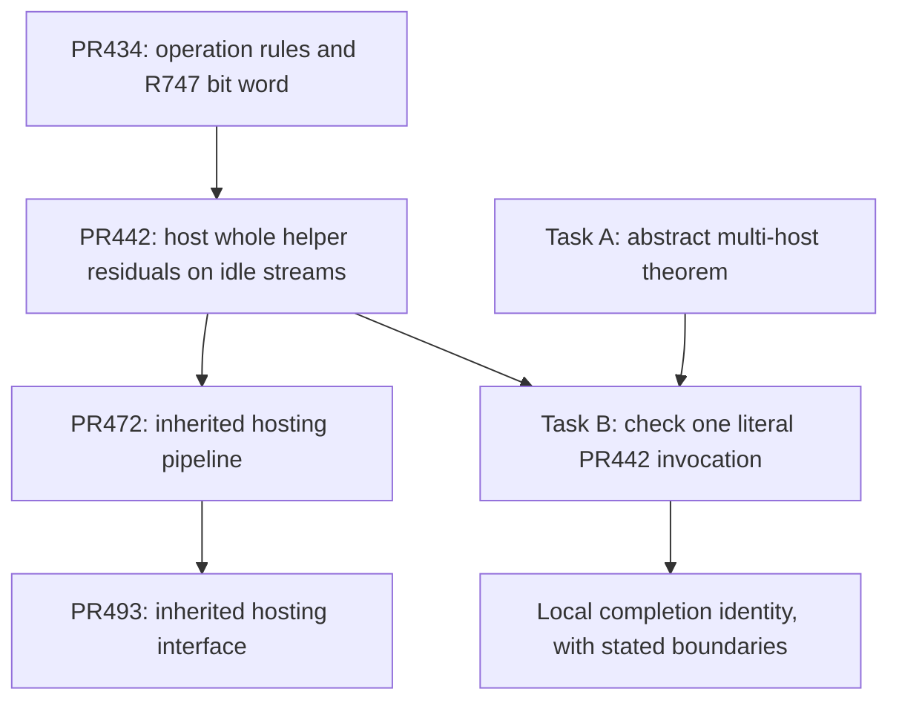
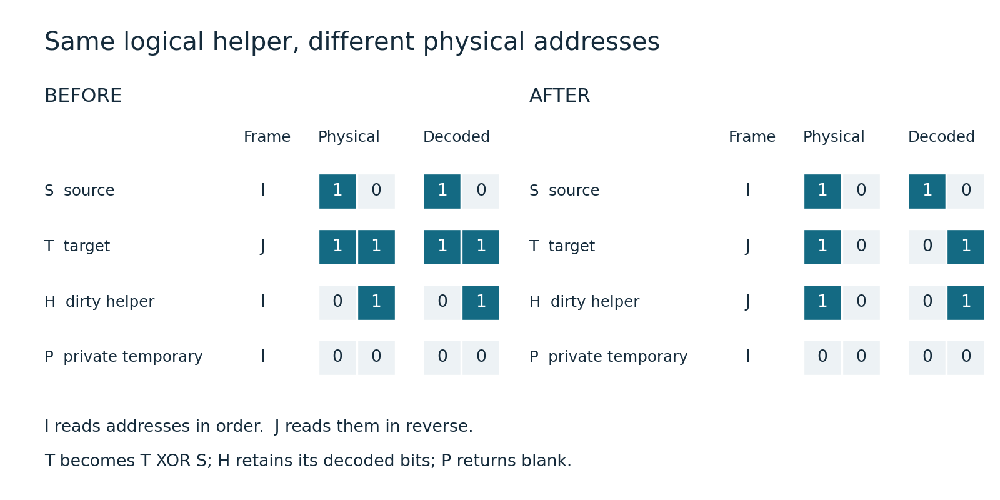
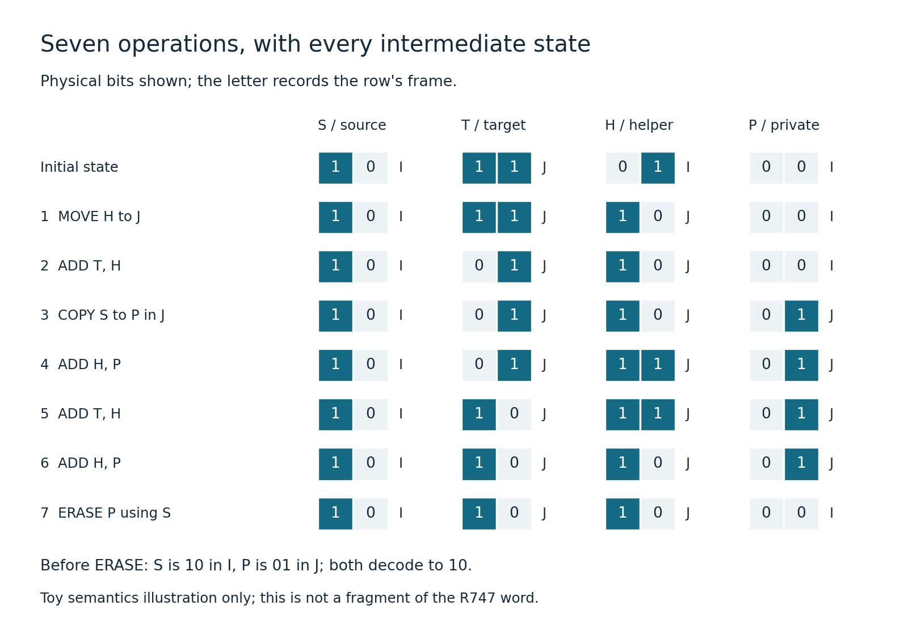
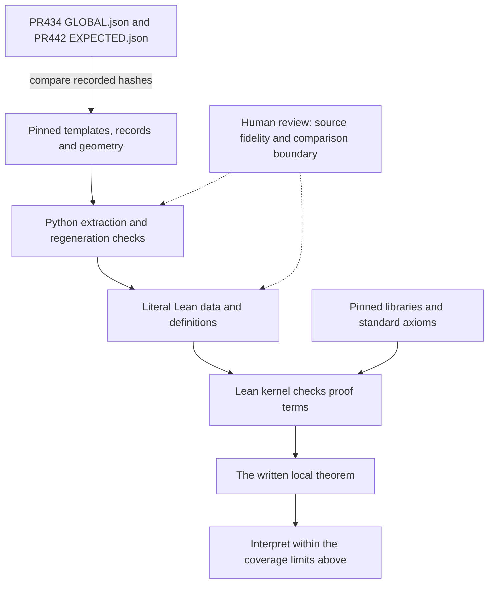

# What checking one hosted invocation tells us

**AI-written explanation, not a human audit.** The human participant initiated
and coordinated the verification effort; no independent human derivation or
personal checking of the mathematics is claimed. Read this alongside the
[PR description](DRAFT-PR.md), [validation report](VALIDATION.md), and
[source comparison](MERGED-OVERLAP.md).
<!-- source: DRAFT-PR.md, attribution and scope; README.md, AI-assistance disclosure. -->

## 1. The place of this result

The useful question is: **can an algorithm borrow storage containing unknown
data, perform its calculation, and leave exactly the promised effect on every
affected stream?** PR442's hosting construction proposes using otherwise idle
data streams for helper work. A complete helper invocation leaves a coordinate
permutation, called its *residual*. When that permutation is part of a change
already scheduled for the idle stream, the later change can be reduced by the
part already performed. This local Lean contribution checks an instance of
that interface; it establishes no multiplication bound or saving in costs.
<!-- source: ../idle-axis-hosting/PROOF.md, sections 1–2 and 5; DRAFT-PR.md, scope limits. -->

Here a **stream** means values indexed by addresses, rather than one scalar
register. The **owner** identifies the actual stream, including its coordinate
map. A **chart** or **frame** tells us how to interpret its addresses. A residual
rearranges addresses within that stream. It is not permission to discard the
unknown values stored there.
<!-- source: ../lean-whole-residual-hosting/CoordinateSwap.lean, Address/Stream/bitAction; ../lean-multi-host-source/README.md, ownership and native-coordinate bridge. -->


<!-- source: ../idle-axis-hosting/PROOF.md, opening and section 2; ../e8-bit-carrier-skeleton/NOTICE.md, PR472/PR442 provenance; ../e8-bit-carrier-skeleton/README.md, inherited interfaces; ../lean-multi-host-source/SourceInvocation.lean, actualContract/selected_call_completion. -->

The lineage arrows describe provenance. Checking a PR442 call does not check a
PR493 call. The selected instance is PR442 commit
`4e16d001d505d4f21dd2bcfc44591f9be4c279bd`, stage 2, replica 0, pair 0,
forward: **19,002 instructions**, **747 dirty helpers**, **240 data streams**,
and **one clean private temporary**. A successful abstract theorem alone would
not show that this particular program satisfies its premises.
<!-- source: ../lean-multi-host-source/source-versions.json, selected_pr442/selected_invocation; ../lean-multi-host-source/SourceInvocation.lean, module introduction; ../lean-multi-host-source/README.md, Task A/B distinction. -->

## 2. Four operations, on a small example

Each row below has two addresses and a Boolean value at each address. Write
`10` for values one then zero. Frame **I** reads addresses in their displayed
order; frame **J** reads them in reverse. Thus physical `10` in J decodes to
logical `01`. This deliberately tiny model uses the package's generic
`FramedReplay` definitions, not the selected call's full matrix geometry or
source-specific frame restrictions.
<!-- source: explainer-figures/make_figures.py, LEAN_EXAMPLE/I/J/bits/view; ../lean-multi-host-source/FramedReplay.lean, Gauge/decodeRow. -->

| Operation | Meaning in the Boolean stream model | Required condition |
| --- | --- | --- |
| **MOVE** | Change one row's frame and rearrange its physical addresses, preserving its decoded contents. | An invertible frame; concrete source restrictions are additional. |
| **ADD X, Y** | Replace X by X XOR Y at matching physical addresses. | Equal frames. This is the odd-coefficient case; an even coefficient does nothing. |
| **COPY S to P** | Transport S into P's specified frame. S is retained. | P must be blank before the copy. |
| **ERASE P using S** | Return P to blank. | P and S must have equal decoded contents at that moment. |
<!-- source: ../lean-multi-host-source/FramedReplay.lean, physicalStep/ValidStep/decode_reframe/erase_guard_transport. -->

“Dirty” means **arbitrary prior contents**, possibly correlated with other
inputs. It does not mean corrupt data or expendable garbage. “Clean private
temporary” means reserved storage known to contain zero everywhere. The real
invocation explicitly starts with such storage; its initializer is not an
operation that clears an arbitrary dirty row for free.
<!-- source: ../lean-multi-host-source/README.md, selected source and comparison boundary; ../lean-multi-host-source/INDEPENDENT-REVIEW.md, retained outputs and dirty inputs; ../lean-multi-host-source/SourceRaw.lean, initial/private_restored. -->

Our example has source S, target T, dirty helper H, and private temporary P.
It performs seven operations. The following figures show the **computed**
states, including the distinction between physical and decoded values.
<!-- source: explainer-figures/make_figures.py, LEAN_EXAMPLE/events/initial and TRACE. -->


<!-- source: explainer-figures/make_figures.py, TRACE[0]/TRACE[-1] and figures(). -->


<!-- source: explainer-figures/make_figures.py, TRACE/STEPS and figures(). -->

Read the second figure as follows. MOVE first changes H's physical `01` to
`10`, while its decoded value remains `01`. ADD temporarily mixes H into T.
COPY places S into the blank P, transported into J. The following ADDs mix S
through H into T and then restore H's decoded value. At ERASE, S is physically
`10` and P is physically `01`, but both decode to `10`: the equality guard
therefore holds. P finishes blank.
<!-- source: explainer-figures/make_figures.py, LEAN_EXAMPLE and TRACE. -->

The cancellation is easier to see without specific bits. In decoded
coordinates, let the initial values be s, t, h. T receives h, then h XOR s,
leaving t XOR s. H receives s twice and returns to h. The actual toy output is
decoded `(S,T,H,P) = (10,01,01,00)`. Notice that “helper restored” needs its
coordinate qualification: H's physical ordering changed. Hosting exploits a
controlled residual of this kind; it cannot simply pretend every physical
helper output equals its input.
<!-- source: explainer-figures/make_figures.py, events/TRACE; ../lean-multi-host-source/LinearReplay.lean, step/evalRows_run; ../lean-whole-residual-hosting/CoordinateSwap.lean, bitAction. -->

The figure script ran this example with Lean **4.21.0**, using
`FramedReplay.physicalStep` and `decodeRow`. Its scratch file also checks the
actual `ValidTrace` predicate for this example. Successful execution alone
would not check the guards: the step function performs writes, while legality
is a separate proposition. This is an illustration, not a fragment of R747,
not the independent differential test, and not a new universal invocation
theorem.
<!-- source: explainer-figures/make_figures.py, check_lean/LEAN_EXAMPLE; ../lean-multi-host-source/FramedReplay.lean, physicalStep/ValidTrace; ../lean-multi-host-source/lean-toolchain. -->

## 3. What Task A and Task B establish

**Task A supplies the composition rule.** A host has some pending coordinate
swaps. Each complete invocation may perform a portion of them while doing its
other work. If those portions are disjoint on each host and lie within that
host's pending set, doing the hosted calls and then the leftovers has the same
retained output as doing the base calls and then all pending swaps:

> hosted calls + remaining swaps = base calls + full pending swaps.
<!-- source: ../lean-multi-host-framework/MultiHosting.lean, multi_hosting/remainders/WindowEvent; ../lean-whole-residual-hosting/CoordinateSwap.lean, bitFactors_complete. -->

`MultiHosting.multi_hosting` proves this for all hosts and all retained state,
on arbitrary inputs. A coordinate set is represented by a *mask*. Disjointness
matters even though swaps commute: swapping the same coordinates twice
cancels, so overlapping masks cannot simply be counted as their union.
<!-- source: ../lean-multi-host-framework/MultiHosting.lean, multi_hosting; ../lean-whole-residual-hosting/CoordinateSwap.lean, swapAddress_commute/swapAddress_involution/swapAddress_disjoint_union. -->

The framework requires complete invocation endpoint contracts. It does not
obtain them by naming some registers “hosts.” `physical_multi_hosting`
connects implementations satisfying those contracts to the composition rule.
`MultiHosting.SingleHost.whole_hosting_recovered` and
`physical_whole_hosting_recovered` recover the earlier single-host results.
Multiple hosts matter because all changed streams must be represented; a
changed second host cannot disappear into a supposedly unaffected remainder.
<!-- source: ../lean-multi-host-framework/MultiHosting.lean, PhysicalContract/physical_multi_hosting and module introduction; ../lean-multi-host-framework/SingleHostRecovery.lean, whole_hosting_recovered/physical_whole_hosting_recovered. -->

The contract also says that, at completion, non-host retained outputs depend
only on the retained non-host inputs, not on the borrowed hosts' arbitrary
contents. Intermediate instructions may mix those contents into data, as in
the toy. Their influence must cancel by the endpoint. Restoring a helper
alone would not establish this stronger obligation.
<!-- source: ../lean-multi-host-framework/MultiHosting.lean, WindowEvent.other/base/PhysicalContract.original_retained/PhysicalContract.relocated_retained; explainer-figures/make_figures.py, LEAN_EXAMPLE. -->

**Task B supplies a concrete contract.** It connects the selected literal word
to actual stream owners, coordinate transformations, inputs, and outputs.
`SourceMatrix.arbitrary_dirty_payloads` proves the normalized endpoint for
arbitrary Boolean payload functions. This is not an enumeration of a few
inputs. In normalized coordinates each target receives its corresponding
source by XOR, and the other live rows are restored.
<!-- source: ../lean-multi-host-source/SourceEndpoint.lean, arbitrary_dirty_payloads/arbitrary_dirty_original_roles; ../lean-multi-host-source/SourceInvocation.lean, actualContract. -->

`SourceInvocation.actualContract` constructs the contract from the actual
execution folds. `selected_call_completion` applies Task A;
`selected_native_completion` states the comparison in common native
coordinates. `selected_native_realization`, `selected_matrix_realization`,
and `selected_original_matrix_realization` connect these descriptions to the
same executions and source matrix word. `selected_native_clean` checks
COPY/ERASE legality along those executions;
`selected_temporary_restoration` proves the private temporary ends blank.
<!-- source: ../lean-multi-host-source/SourceInvocation.lean, declarations named in this paragraph. -->

The comparison retains affected hosts, active data and exterior streams.
Original-bank outputs remain actual auxiliary outputs: they are carried
through the contract, not silently reset or asserted equal to their inputs.
Later code observing those outputs would need a suitable additional argument.
Merged formal work already has abstract arbitrary-state theorems; this
contribution's distinction is its concrete local obligations in its own model.
<!-- source: ../lean-multi-host-source/README.md, comparison boundary; ../lean-multi-host-framework/MultiHosting.lean, PhysicalContract; MERGED-OVERLAP.md, what Task B adds. -->

## 4. Coverage map

| Status | What belongs here | Boundary |
| --- | --- | --- |
| **Proven in Lean** | Task A's conditional composition theorem; Task B's literal endpoint, concrete ownership, coordinate identities, chronological guards and temporary restoration. | The application has **one complete invocation** as its event. Ownership inside that call is proved; cross-invocation disjointness is not exercised. |
| **Checked by testing only / external computation** | Python source extraction and regeneration; the toy's evaluated states. A differential test against PR434's `bit_global.py` would be **testing, not proof**. | Python is not a verified compiler. The differential test is **not in this branch**, and no passed result for it is claimed here. |
| **Assumed or hand-supplied** | An address field with `2 ≠ 0`, an invertible chart, explicit input embeddings, a clean private temporary, and pending ranges **15..21** and **1..28**. | Lean checks that the ranges contain the target masks. Neither Lean nor extraction binds those ranges to the source schedule. The initializer supplies permitted clean storage. |
| **Not covered** | Full cover sweep, later scheduling, equivalence of arbitrary complete global allocations, costs, all-size compilation, analytic transfer, or **κ**. | Immediate completion after this call is not identified with the later recursive schedule. No PR448 split-helper gain is established. |
<!-- source: DRAFT-PR.md, scope limits; ../lean-multi-host-source/README.md, comparison boundary; ../lean-multi-host-source/PhysicalSourceConnection.lean, pendingTag/tag_pending_contains/selected_invocation_completion; ../lean-multi-host-source/SourceInvocation.lean, parameters and selected_call_completion; explainer-figures/make_figures.py, check_lean. -->

The field condition concerns **address geometry**; the payloads themselves are
Boolean and combine by XOR. The explicit input embeddings also matter: the
theorem does not quantify over two independently arbitrary complete memory
allocations and declare them equivalent.
<!-- source: ../lean-multi-host-source/SourceInvocation.lean, K/h2/d and actualContract A := Bool; ../lean-multi-host-source/README.md, comparison boundary. -->

## 5. Useful next steps, with difficulty estimates

These are proposed directions, not completed results. First, derive the pending
masks from the actual schedule and prove their meaning. The existing containment
check can then attach to a source-derived object. This looks bounded, but
requires the exact interpretation of recipe positions and coordinate charts;
substituting a generated list for a handwritten list would not finish it.
<!-- source: ../lean-multi-host-source/README.md, pending-coordinate limitation; ../idle-axis-hosting/PROOF.md, hosting windows. Difficulty is a planning judgment about those outstanding obligations. -->

Next, connect another selected call, eventually a whole parameterized family
of calls. The extraction and certificate machinery offers a starting point,
but each connection must cover its actual owners, frames, private storage and
arbitrary dirty inputs. Provenance through PR472/PR493 is not that connection.
Expect substantial instance work before claiming a general compiler theorem.
<!-- source: ../lean-multi-host-source/SourceInvocation.lean, fixed invocation; MERGED-OVERLAP.md, provenance boundary. Difficulty is a planning judgment. -->

Then prove a common global allocation and schedule: which calls can share
streams, whether residuals are disjoint, what intervening operations observe,
and where leftover swaps actually occur. This is a larger mathematical step
than replaying another word. Integration with the merged abstract packages
also needs an explicit adapter between their state models and this one.
Only after those interfaces are justified should cost accounting, all-size
compilation and the analytic route to κ be attached.
<!-- source: ../lean-multi-host-framework/MultiHosting.lean, PhysicalContract and disjointness premises; MERGED-OVERLAP.md, scheduling, #528 adapter and scope boundaries; DRAFT-PR.md, maintainer questions. Order and difficulty are proposals, not verified conclusions. -->

## 6. The trust chain

There are separate questions: **did Lean establish the written statement?**
and **is that statement about the intended source program and interface?**
The source connection needs both. File hashes help identify inputs; they do
not prove that the model faithfully describes the intended algorithm.
<!-- source: VALIDATION.md, integrity and limitations; ../lean-multi-host-source/check_sources.py, module description; ../lean-multi-host-source/INDEPENDENT-REVIEW.md, source boundary. -->


<!-- source: ../e8-early-reset-kernel/local-evidence/GLOBAL.json; ../idle-axis-hosting/EXPECTED.json; ../lean-multi-host-source/source-versions.json; ../lean-multi-host-source/check_sources.py; VALIDATION.md, integrity and limitations. -->

The parent template's uncompressed hash matches PR434's
[`GLOBAL.json`](../e8-early-reset-kernel/local-evidence/GLOBAL.json)
`template_sha256`; the hosted template's hash matches PR442's
[`EXPECTED.json`](../idle-axis-hosting/EXPECTED.json) `bit_template_sha256`.
The record, geometry and canonical forward-word hashes also match the PR434
record. These comparisons identify the supplied bytes, not every assertion
in those upstream reports. `check_sources.py` checks all six pinned input
hashes, reconstructs the word in order, and regenerates certificates.
<!-- source: ../lean-multi-host-source/source-versions.json, inputs/selected_invocation; ../e8-early-reset-kernel/local-evidence/GLOBAL.json, template_sha256/source_records_sha256/geometry_sha256/local_checks.forward.sha256; ../idle-axis-hosting/EXPECTED.json, bit_template_sha256; ../lean-multi-host-source/check_sources.py. -->

The proof rests on Lean's kernel and the accepted standard principles
`propext`, `Quot.sound`, and `Classical.choice`, as recorded by the axiom audit.
In plain terms, these let logically equivalent propositions count as equal,
let related representatives denote the same quotient object, and select an
element of a nonempty type without requiring a selection algorithm.
<!-- source: validation/lean421-fresh.json, audits; explainer-figures/make_figures.py, LEAN_EXAMPLE axiom-signature checks. -->

The installed toolchain and imported library artifacts also matter. The fresh
build recorded their fingerprints, but did not rebuild every external library
or freshly audit every imported constant. Receipts and manifests document
consistency; reading a PASS record is not independently rerunning Lean.
<!-- source: validation/lean421-ci-fix-fresh.json, toolchain/dependencies/audits; VALIDATION.md, CI compatibility repair and integrity/limitations; ../e8-lemma-g-lean/README.md, trust boundary. -->

A reader need not trust the AI's confidence, a claim of helper independence,
or a few successful bit assignments as a substitute for the arbitrary-input
theorem. Nor must the reader assume PR448's disputed interface. A reader
**does** still need to assess the definitions, the external extraction boundary,
the explicit clean-storage premise, and whether the comparison is sufficient
for the intended continuation. The diagrams make those questions accessible;
they are not additional certificates.
<!-- source: README.md, disclosure and scope; ../lean-multi-host-source/SourceEndpoint.lean, arbitrary_dirty_payloads; ../lean-multi-host-source/INDEPENDENT-REVIEW.md, retained outputs and source boundary; DRAFT-PR.md, maintainer questions and PR448 limitation. -->

To regenerate the figures, run from the repository root:

```sh
python3 -m pip install -r research/lean-external-review/explainer-figures/requirements.txt
python3 research/lean-external-review/explainer-figures/make_figures.py
```

After the pinned dependency setup in [BUILD.md](BUILD.md), add
`--check --check-lean` to compare the PNG bytes and rerun the temporary Lean
example. No existing Lean source, theorem, Lake configuration, toolchain or
proof receipt is changed; the scratch file is outside the checkout and is
removed afterward.
<!-- source: explainer-figures/make_figures.py, main/check_lean/figures; explainer-figures/requirements.txt; BUILD.md. -->

This documentation addition updates the package's file inventory only. Existing
proof receipts and `package-validation.json` retain their original bytes and
describe their original runs. Run `verify_package.py` without `--receipt` to
check the current inventory without replacing those records.
<!-- source: package-manifest.json, sha256; verify_package.py, main/port_bindings; package-validation.json, manifest_sha256/files_checked. -->
