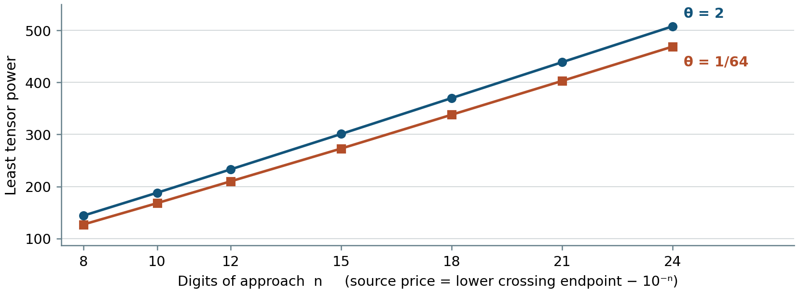

# What limits the P104 multiplication exponent?

*Exact results toward κ = 0.00389046    ·    22 November 2026*

**Abstract.** We test whether sending fewer bits or paying less for their transport can improve the P104 signed integer multiplier. We prove that the fixed 630-output binary operator needs exactly nine downward one-bit transmissions. The converse allows nonlinear local encoders and feedback. An explicit word attains nine, down from 27, but increases the rank-weighted tariff. If the upward receipts and two feedback deadlines stay fixed, every direct return must pay the maximum rank. In a separate calculation we attain κ = 0.003890115286594445 under the five P104 premises and prove it is the largest reporting tick for the specified six-stage construction. At the requested 0.00389046 the fixed word still spends 0.132405116496822… more than it earns. Seven correct placements of a balanced fusion would cover the deficit. The literal fusion saves the predicted price and misses one bit. We prove that this error survives every nonempty subset of the 36 placements.

### What is being optimized

For signed integers of at most n significant bits, the P104 transfer yields a fixed-alphabet multitape algorithm with the following time bound under its five framework premises.

$$
T(n)=O(n(1+\log  n)^{1-\kappa }).
$$

The starting complete conditional comparison was κ₀ = 0.0038901152865907 in PR #8035. The binary service limits this construction. The numerical service and the signed multiplier must also admit the same κ. Ali Romman’s concurrent PR #8042 now matches our six-stage rate of 0.003890115286594445. Its seven retimed receivers use the same raw binary inventory at smaller ranks. Canonical main selects the independently reviewed conditional value 0.00363005817. [1–4]

### Why the investigation changed direction

The previous paper priced a shorter route before establishing where its displaced bit would go. Here we start with three measurable questions. How far can the existing invoice carry a complete multiplier? Which bits must cross each boundary, even after recoding? Can a program realizing a smaller communication count also pay less? The first question admits a finite witness and a matching upper bound. The last two give a 27-to-nine construction, a converse and a counterexample to message count as a proxy for cost. [2, 5, 6, 9, 11]

## 1   The price of crossing chart boundaries

In the normalized binary model, each owner holds one bit on the constant-field subclass, an ADD takes XOR in a common chart, and a MOVE transmits one bit between nested charts. Its rank is the absolute difference of their dimensions. Scheduled contacts and clocks are independent of the input. A SWAP exchanges register names together with their chart placements. Fix the 630 prescribed public endpoints. Arbitrary local memory and deterministic binary recoding are allowed for the cut bounds. Address-dependent encodings into larger fields require their own model.

For each j from 1 to 8, collect all charts of dimension at least j. Fix every initial bit inside this set at zero. The rank dⱼ of the remaining demanded output forms counts how many independent external bits the set must learn. A protocol with fewer than dⱼ incoming one-bit contacts has fewer possible transcripts than demanded output vectors. This is the elementary information cut underlying network-coding converses. [9, 10]

| Threshold j | 1 | 2 | 3 | 4 | 5 | 6 | 7 | 8 |
| --- | ---: | ---: | ---: | ---: | ---: | ---: | ---: | ---: |
| Demand dⱼ | 516 | 627 | 627 | 627 | 616 | 616 | 616 | 505 |
| Native arrivals | 516 | 627 | 627 | 627 | 616 | 616 | 616 | 505 |

**Theorem 1   Sharp upward rank sum.** Every correct protocol in this scalar model spends at least 4,750 upward rank units, and the native word attains equality. An upward contact of rank r crosses exactly r thresholds. Summing the eight inequalities gives the lower bound. All eight counts are exact on the literal word, which proves attainment. Thus shortening any of its 2,776 upward contacts requires an offset elsewhere, even with new senders, arbitrary payloads and changed deadlines. [9]

**Price with only the eight cuts retained.** Order the layers by decreasing demand as 2, 3, 4, 5, 6, 7, 1, 8. Give position j weight $j^{t}-(j-1)^{t}$, where 0 < t ≤ 1. Concavity makes the weight of any r positions at most $r^{t}$. A matching integer cover uses 505 intervals of length 8, eleven of length 7, one hundred of length 6 and eleven of length 3. These are the four distinct demand superlevel sets and each consists of consecutive physical dimensions. Thus the weighted sum is the exact relaxed optimum. At the target it is 4712.55892449954… against the actual native upward price of 4737.61892078314… . The difference of 25.05999628360… per native call measures room in the cut constraints. It acquires an algorithmic value only when actual chart incidences, fields and causal readers realize it. [9]

## 2   Why eight downward bits cannot suffice

Each of 111 main ports maps (xᵢ,yᵢ) to (xᵢ,xᵢ + yᵢ). A further 408 helpers are independent inputs. The bit xᵢ starts at rank-one projector Hᵢ, yᵢ at chart zero, and xᵢ + yᵢ ends at Bᵢ = I − Hᵢ. Upward MOVEs follow projector inclusion. Which inputs can reach Bᵢ using upward transfers alone? [9, 11]

**Theorem 2   Minimum downward count.** Exactly nine downward one-bit contacts suffice for the fixed operator. The lower bound allows free upward traffic, new intermediate charts, unlimited local memory and arbitrary nonlinear Boolean encoders on a fixed schedule.

**Reduction.** Give every chart the entire downward transcript Y. Set the helpers, the yᵢ and all unselected xᵢ to zero. By transitivity of inclusion, induction over the operations allows a chart P to see only Y and the xⱼ with Hⱼ ≤ P. Thus receiver i must recover xᵢ from Y and the xⱼ whose projectors Hⱼ are orthogonal to Hᵢ. Rational projection checks all 111² relations. This is index coding with receiver side information. [11–13]

No member of K = {0, 14, 15, 30, 31, 60, 69, 70} observes another member’s input. Five outside ports each see a pair in K. Put their independent bits zₑ on the edges below.


*Figure 1. Four ports of K and the five outside ports that see the indicated pairs.*

Distinct edges that share an endpoint cannot observe each other. Give each edge all bits on disjoint edges as additional side information. For a fixed five-bit z, the eight K bits must all be recovered from Y and z. If Y has at most eight bits, every possible transcript occurs exactly once among those 256 input choices. Fix one transcript. Its fiber contains all 32 outside words z. In that fiber, a clique vertex c has a value $h_{c}$ depending only on its incident outside bits.

For an edge e = cd, its receiver must distinguish zₑ = 0 from zₑ = 1 given $h_{c}$, $h_{d}$ and all disjoint-edge bits. Fix those disjoint bits. Conditional on zₑ, the remaining inputs of the two endpoint functions range independently. Their attainable pairs are therefore rectangles A₀ × B₀ and A₁ × B₁. The rectangles must be disjoint. One coordinate has disjoint nonempty binary ranges, so one endpoint function equals zₑ or its complement on every input. An endpoint function cannot do this for two independent bits. Five edges would require five endpoints among four, a contradiction. The earlier E8 Hall certificate inspired this 13-port choice. The fiber argument extends the obstruction to nonlinear encoders. [11, 12]

## 3   A word attaining nine, and its exact bill

Each native return takes a three-MOVE path. For its final field f, solve f = p + q over 630 input coordinates, with p in the live stock of chart 1 and q in that of chart 0. All nine systems have solutions. Form p, move it from the identity to zero, and add q. The two intermediate owners have no later readers before their clears. All surviving fields agree at each block exit, so the replacements compose and attain the lower bound. [11]

| Literal word resource | Native | Constructed |
| --- | ---: | ---: |
| Upward / downward contacts | 2,776 / 27 | 2,776 / 9 |
| Total MOVEs | 2,803 | 2,785 |
| Upward / downward rank sum | 4,750 / 63 | 4,750 / 72 |
| Private clears / peak live owners | 3,433 / 4,063 | 3,415 / 4,045 |
| Local XORs | 29,301 | 29,299 |

Eight returns use only chart-1 donors. The ninth also uses owner 351 at chart zero. The word saves 56 instructions and two XORs. Independent replay recovers the forward and transpose operators and every retained clear, including all 408 arbitrary helpers in the inputs. Deleting one donor breaks 55 rows. [11]

**Theorem 3   Price of nine direct returns.** Suppose all upward receipts keep their original values, charts and clocks, the only other traffic consists of nine one-bit returns directly to zero, and the first eight completed values are required by clock 11104, all nine by 18875. Then every downward sender must be chart 1. The sharp downward tariff is $9\cdot 8^{t}$.

**Proof.** The nine required fields F have rank nine modulo the 516-dimensional initial stock Z of chart zero. At each fixed Z, nine received bits must distinguish all 512 values of F. Their transcript is a bijection of F. For each sender compute its total available stock through the first deadline modulo Z. Its intersection with the span of F in this quotient has dimension zero at every chart except chart 1, where it is nine. For zero intersection, bases of the two subspaces range independently at fixed Z. A bit computable from both is constant there, contradicting the bijection. At least eight bits arrive early. If exactly eight do, their transcript determines the first eight returned fields bijectively at fixed Z. Adjoin these to Z and repeat the calculation at the last deadline. Only chart 1 contributes the final new dimension. Two implementations checked these 1,272 intersections. [11]

At t = 1 − 0.00389046 the old downward bill is 62.723423052300506… and the optimal direct bill is 71.419870923429786… . With all 36 native calls replaced the full raw deficit grows to 313.204528477150898… . Fewer downhill transmissions cost more in this exact implementation. [11]

## 4   A complete repair of the chart 531 relay

The proposed local shortcut sends a field f from chart 326 through 531 to 1. It makes the native rank-two contact at instruction 8075 cost one. With the other incidences fixed it cannot compute the full operator, even with arbitrary binary encoders. Three messages enter chart 1 through 531 by instruction 10141, with at most two independent bits entering that initially empty chart by then. The other 502 incoming chart-1 messages can add at most 502 bits. Chart 1 owes 505 independent outputs. [5, 9]

This count is sharp. Chart 1 has at most 2⁵⁰⁴ decoded outcomes, each with at most 2¹²⁵ complete inputs in its fiber. Hence at most 2⁶²⁹ of 2⁶³⁰ inputs can succeed. The literal shortcut attains this on the kernel of one nonzero 27-input parity. For k independent copies and m extra binary side messages, the same argument gives optimal success fraction $2^{-\max (0,k-m)}$ when the m residual bits can be supplied before their readers. This last attainment gives an information requirement in the side-message model.

### Replacing the missing information with real transfers

Write f, u and v for owners 1855, 1857 and 2224 at chart 326. The shortcut delivers f to chart 1, displacing f + u + v at 531. There is a constructive repair that never asks for an oracle value. First, at 10138 send v directly from chart 326 to 1 and add the already present f + u. This restores the desired receipt and all 505 chart-1 outputs at once. It costs back the saved unit and leaves exactly public output 117 incorrect.

To supply that output, reroute owner 3152 from 328 → 8 to 328 → 0 at 11022. Owner 3153 can now carry x₆ to chart 0, where an ADD restores its original value for all its other readers. At chart 0 the existing owners can produce x₁₁₇ + x₆. Send this on the original 0 → 7 → 330 → 531 route and assign its value to output 117. Direct replay and a separate reverse interpreter verify all 630 × 630 coefficients and the original endpoint placements. Removing the last source term fails on output 117. [9]

The repair uses 2,803 paid MOVEs and 109 fewer local ADDs. Its net tariff change is a rank-five contact becoming rank six. For one replacement in the full caller, the raw trial margin is −1.121935400785230928… and the 268-factor margin is −0.001060813460434955… . Five of the 3,433 private clear records change. The attained result is an all-input normalized binary operator with a known cost. A physical field adjoint, owned erasure and signed price would be additional obligations for adopting that word.

## 5   A price filter for proposed fusions

Give a candidate word its full paid rank histogram nᵣ and write G = Σ r nᵣ for its total grade. A grade-conserving fusion can still change cost. To measure that change exactly, define Eⱼ = Σ nᵣ max(r − j, 0) for j = 1, …, 7. It counts the grade above level j across the paid contacts. For 0 < t < 1, the tariff gives a positive curvature weight at each integer.

$$
w_{j}=2j^{t}-(j-1)^{t}-(j+1)^{t},     \sum _{r=1}^{8}n_{r}r^{t}=G-\sum _{j=1}^{7}w_{j}E_{j}.
$$

**Derivation.** For a single contact of rank r, start from the first difference 1. Each subsequent difference decreases by wⱼ. Summing these first differences to r gives $r^{t}=r-\sum _{j=1}^{r-1}(r-j)w_{j}$. Summing over contacts gives the displayed identity. For a change from old to new inventory, the saving is Σ wⱼ ΔEⱼ − ΔG. Every extra paid grade therefore raises the improvement the higher ranks must deliver. This is a discrete summation identity applied to the actual eight-rank tariff. [9]

For the native upward word and its sharp interval relaxation, ΔG is zero. The seven tail increases are 2,149, 2,967, 2,539, 2,067, 1,554, 1,020 and 505. The first two terms account for 11.574637158869… and 6.001777803623… of the 25.059996283598… relaxed gap. Those numbers rank the scale of possible savings without promising that the matching intervals can carry the required fields. [9]

**How many real fusions would suffice?** For positive ranks a and b with a + b ≤ 8, the saving is aᵗ + bᵗ − (a + b)ᵗ. Concavity bounds this by (2¹⁻ᵗ − 1)(a + b)ᵗ. Equality holds at a = b, and the right side grows with a + b. Thus 4 + 4 → 8 gives the maximum per elementary grade-conserving fusion, $2\cdot 4^{t}-8^{t}$. At the trial it saves 0.02142834703346313… . Six such fusions can save at most 0.128570082200779… , less than the raw deficit. Seven balanced fusions exceed it at the histogram level, assuming all other charges and productive ranks stay fixed. This is a sharp **price** threshold for the stated class.

To test attainability, first require the destination chart of an earlier upward MOVE to equal the source chart of the later MOVE. Exactly one native 4 + 4 pair survives this order-and-incidence test per 111-port call. For comparison 4,227 ordered 2 + 2 pairs survive. Each still needs compatible data, available local stocks, correct public outputs and legal ownership through its first and last readers. [9]

## 6   One missing bit survives all 36 placements

The only native ordered 4 + 4 pair uses chart 0 → 509 at clock 7112 and chart 509 → 1 at 7210. Its inputs differ. The first carries helper 626 and the second main input x₃₈. We sent the helper directly to chart 1 at rank eight and reconstructed the other demands from live stocks. The resulting literal program saves 0.021428347033463130… per placement. Independently replaying the graph and its transpose shows 629 exact outputs. The remaining output is y₁₉ + x₁₉ + x₃₈, where y₁₉ + x₁₉ is required. All 3,433 private clears remain, with seven changed symbolic values. [17]

Could the downstream caller absorb the extra term? On binary constant fields, group the 38 caller roots into two lanes with offsets b = 0 and b = 19. Within each lane let s run from 1 to 18. Let eⱼ denote the standard basis vector of length 38 and set u = eᵦ + eᵦ₊ₛ. Following the source pre- and post-operations through one call gives the following transfer from root port 38 to root port 19. It reads the two inputs indexed by b and b + s and adds their sum to those same two output roots.

$$
\Delta A_{b,s}=u_{b,s}u_{b,s}^{T},     u_{b,s}=e_{b}+e_{b+s},     \Delta A_{b,s}\in \mathbb{F}_{2}^{38\times 38}.
$$

**Proposition   No cancellation across placements.** Every nonempty subset of these 36 literal substitutions fails on a legal input of the complete binary supplier. The errors add linearly because a substituted call writes to port 19 and subsequent discrepancies read only port 38. For any chosen (b,s), the diagonal coordinate (b + s, b + s) occurs in its error matrix and in no other. Give its port-38 input root a single one, with every other input zero. The corresponding port-19 output flips. This one argument excludes all 2³⁶ − 1 = 68,719,476,735 nonempty subsets. The cutoff admits the witness on a tensor slice because 4 × 127²⁶⁷ exceeds 15²⁶⁸. [17]

This failure is visible even to an observer who retains the four native chart-544 arrivals of the literal fused word. Flipping input bits 19 and 38 together leaves those four observations unchanged and flips the required output. No terminal decoder can repair that word from what arrives. The all-subset statement follows from the caller’s private diagonal coefficients, which were independently reproduced by tracing prefixes and adjoints. [17]

*The converse fixes this literal local word and the 36-call source interface. It permits all placement subsets. Other local encoders, other paid incidences and the subset of fields reachable from specific integer operands require separate arguments.*

## 7   What would fund the target exponent

Suppose a corrected word realizes the balanced fusion at q of the 36 calls, with all other charges, productive labels and ownership obligations unchanged. The raw binary margin at the target is the baseline margin plus q times the per-fusion saving. The seven-placement scenario can also be priced through the finite binary band, the 48-call numerical service and the outer signed algorithm. This tests whether a legally reconstructed bit would really be worth pursuing. [17]

| Scenario at κ = 0.00389046 | Placements | Raw binary margin |
| --- | ---: | ---: |
| Unmodified word | 0 | −0.132405116497 |
| Balanced fusion | 6 | −0.003835034296 |
| Balanced fusion | 7 | +0.017593312737 |
| Balanced fusion | 36 | +0.639015376708 |
| All fused, plus one rank-one charge | 36 | −0.360984623292 |

**Finite sufficient invoice.** Set c = 140170034802279 / 2⁵⁵, approximately 0.00389050. With 268 factors, cutoff 2⁵⁰ and split coefficient 1/64, seven valid fusions give normalized binary surplus above 2.1081285565 × 10⁻⁶. The required rounding charge is 2/2⁵⁰. The paid binary debit is 21 bits. Six binary rank logarithms, in order, are 25,000,000, 160,000,000, 1,000,000,000, 6,000,000,000, 36,000,000,000 and 224,000,000,000. All six stage inequalities pass. [17]

The unchanged numerical word has positive raw margin 8.131421620012920900… at the target. Its own 128-factor band and 10-bit debit at rank log 1,600,000 give a numerical cap of 0.0038904632568359375. With ordinary rate 0.0038904998 and stopping gap 10⁻¹⁴, all 54 strict and four functional signed conditions pass. The smallest strict margin is 10⁻¹⁵. Equality and a charged rank-one restoration provide failure controls. These are checks on a precisely specified conditional invoice. [2, 17]

**The remaining construction.** The literal word of Section 6 fails the operator test at every nonempty subset of placements. Even 36 perfect fusions could not pay one uncompensated rank-one repair. An improved word must therefore restore x₃₈ through information already in the paid schedule, or supply another genuine saving. It must also return the owned physical fields and preserve the numerical precision and analytic transfer on the altered path. The priced implication states exactly what such a construction would earn.

## 8   A finite rate and a matching limit

Let c denote the funded binary source price, d its complete debit in bits, and Hᵢ the base-two logarithm of the i-th stage rank. Starting with b₀ = 0, the six-stage ordinary service imposes the strict recurrence below. The component cap is η = 0.0039. [2, 3]

$$
C_{i}=c-\frac{d}{H_{i}},     b_{i}<\min (\eta ,\frac{249C_{i}+b_{i-1}}{250}).
$$

Each stage loses a factor of 1/250 on the gap still inherited from the preceding one. Even with vanishing debits, induction gives $b_{6}<c(1-250^{-6})$. To obtain the actual reporting limit one must also keep the prescribed rounding. Write S = 10¹⁸. At stages one through five the code takes the floor of S times the stage limit, subtracts one tick and divides by S. The sixth ordinary rate can be any strictly admissible rational.

**Theorem 4   Six-stage grid optimum.** For the pinned raw inventory and this selector, the largest κ on the grid of multiples of 10⁻¹⁸ admitted by the conditional ideal-tape construction is 0.003890115286594445. Its immediate successor on that grid is excluded. The statement fixes the raw word, recurrence, rounding and the P104 outer premises.

**Upper bound.** Let c* be the raw crossing isolated in Section 10. Take u₀ = 0 and use c* in place of the finite, debited price. At each of the first five stages the largest possible tick is the ceiling of $S(249c*+u_{i-1})/250$ minus two. The subtraction accounts for the strict approach from below and the additional one-tick margin in the code. Both endpoints of the directed crossing interval give the same five integers. [2, 6]

| Stage | Largest tick | Stage | Largest tick |
| ---: | ---: | ---: | ---: |
| 1 | 3,874,554,825,448,082 | 4 | 3,890,115,285,598,590 |
| 2 | 3,890,053,021,749,874 | 5 | 3,890,115,286,590,476 |
| 3 | 3,890,115,037,627,081 | 6 | strict rational rate |

Substitution of the fifth rate gives a sixth-stage limit between 0.003890115286594445189476954232 and 0.003890115286594445189476955228. The next reporting tick, 0.003890115286594446, exceeds even this zero-debit bound. The finite construction on the next page attains the preceding tick.

## 9   Construction and verification

To produce a witness close to the upper bound we first choose a binary price strictly below the raw crossing. We increase the tensor power until the removed productive columns and paid split remainders fit the remaining surplus. Then we choose binary ranks large enough to pay each ordinary debit. A positive stopping margin keeps both suppliers strictly inside the signed application. No transfer is deleted from either underlying word.

| Installed parameter | Value for the final reporting tick |
| --- | --- |
| Binary price c | 1175715202810401744919 / 2⁷⁸ |
| Binary power and column cutoff | 430 and 2⁷⁰, with productive floor 15⁴³⁰ and paid cap 12⁴³⁰ |
| Binary stage log-ranks Hᵢ | 10²¹ × 4ⁱ for i = 0, …, 5 |
| Positive service | 128 factors, rank log 1,600,000, cutoff 2¹⁵ |
| Debits and stopping margin | 31 binary bits, 10 positive bits, g = 10⁻²¹ |
| Ordinary rate | 0.003890115286594445005 |

The literal 36-call binary inventory has 18,906 productive and 104,904 paid labels. Two outward arithmetic methods certify a positive normalized surplus above 3906 × 10⁻²¹, which exceeds $2/2^{70}$. All six stage inequalities are strict. The positive 48-call supplier pays its own 10 bits. The ordinary rate exceeds κ + 4g by g. All 54 strict inequalities and four functional conditions of the signed gate pass, with least margin 10⁻²². Equality at either supplier gate is a rejecting control. [2, 6]

**Execution evidence.** The feasible signed control multiplies −741503 by 466013 and returns −345550037539 using 138 CRT shuttles and 157,248 H calls. The product is bound to this profile. Its 32-site geometry selects the local H kernel. Separate controls exercise the large-case supplier arguments and the stopping predicate. A separate 81 × 81 comparison, literal operators, rational atlas and ownership controls exercise the components. The production ranks are too large for this host. The full-size assertion concerns a mathematical tape machine, for which the finite constants and all-size inequalities must be proved.

At these ranks the earlier convenience bound G < 2⁵⁰ for forest height fails. The ratio of least retained to greatest split rank gives $G+1\le ⌈13H/(4v)⌉+2$. Including the enlarged counters in the slot calculation gives overhead logarithm 26,038, below the 53,044 local bound and the allocated 65,536. An explicit tape writer handles the fixed binary counters. The stopping comparison uses at most 98 capped products. The quotient entrance uses η = 39/10000. The paper retains the five premises of all-column native action, owned erasure and restoration, compiler transfer, precision and tape accounting, and analytic recovery. [2, 3, 6]

## 10   Why tensor powers have diminishing returns

For s ≥ 0 write $T(s)=\sum _{r}T_{r}r^{s}$ and $P(s)=\sum _{r}P_{r}r^{s}$ for the productive and paid rank moments of the complete binary caller. The raw margin is $D(c)=T(1-c)-P(1-c)$. The two inventories are finite and their coefficients are integers. Differentiating term by term and enclosing the powers and logarithms on 0.00389 ≤ c ≤ 0.00389046 gives −384104 < D′(c) < −384101. Opposite endpoint signs locate the unique crossing c* between 0.003890115286594461129996942 and 0.003890115286594461129996943. The raw deficit at the requested target is 0.132405116496822… . [2, 5, 6]

Put t = 1 − c, z = 593/2048, w = 491/1024. The three ratios below measure the original paid mass, the tail above the paid cap, and the productive mass lost below its floor. The normalized binary surplus after v factors is $F_{\theta }(v)=1-\alpha ^{v}-\theta \gamma ^{v}-\lambda ^{v}$. Both θ = 2 and θ = 1/64 have established split-tariff proofs. [2, 3, 7]

$$
\alpha =\frac{P(t)}{T(t)},      \gamma =\frac{P(t+z)}{12^{z}T(t)},      \lambda =\frac{15^{w}T(t-w)}{T(t)}.
$$

**Theorem 5   Tensor threshold.** Let δ = 1 − α, A = log(1/δ), and a = −log γ(c*). With arbitrary finite column cutoff L, the first usable integer power is ⌊x⌋ + 1, where x is the unique positive real zero of Fθ. As c increases to c* from below, the zero satisfies

$$
a x=A-\log  A+\log (a\theta )+o(1).
$$

**Proof.** The interval bounds give γ < 0.907227 and λ < 0.900011, with γ > λ throughout. From the left, α < 1 and δ is proportional to c* − c because D′ is bounded away from zero. Thus Fθ increases from a negative value to one. Any positive surplus funds a finite L > 2/Fθ. At and above the crossing α ≥ 1, so no power passes. This proves the exact supremum for this sufficient moment test.

As δ decreases to zero, x tends to infinity. Taking a sufficiently large constant C and x = CA makes both tails O(δ²), while $1-(1-\delta )^{x}\ge \delta $. Hence the true zero is O(A) and xδ tends to zero. Smoothness gives $\gamma (c)^{x}=\gamma (c*)^{x}(1+o(1))$, and the λ tail is smaller by a factor tending to zero. At the zero, $x\delta =\theta e^{-a x}(1+o(1))$. Taking logs twice gives the displayed formula. This logarithmic inversion is also the classical Lambert W expansion. [6, 8]

## 11   What the threshold predicts

The crossing gives γ(c*) = 0.907225472004138239146095… and a ≈ 0.09736427. The leading price of approaching it is about 10.27 additional tensor factors per natural-log unit of relative raw surplus. Replacing θ = 2 by θ = 1/64 saves asymptotically log(128)/a ≈ 49.83 continuous factors. The two integer thresholds also have a rounding difference of less than one relative to their continuous difference.



*Figure 2. Each marker is an exact integer threshold. Outward intervals prove failure at the previous integer and success at the displayed one. The lines connect the verified values. The real-column cutoff may be chosen after the power. [6]*

For example, at 10⁻¹⁸ below the lower crossing endpoint, the two certified first powers are 370 and 338. At 10⁻²⁴ they are 508 and 469. A prescribed L can require a larger v because it also imposes Fθ(v) > 2/L. The 430-factor installation pays that finite rounding cost. A second, separately tested 384-factor installation gives κ = 0.003890115286594430 with a smaller binary debit of 28 bits.

### Where the target deficit comes from

The six-stage conditional lower endpoint improves on #8035 by 3.745 × 10⁻¹⁵. The new lower endpoint remains below the predecessor’s directed raw upper crossing. The remaining distance to 0.00389046 is 3.44713405555 × 10⁻⁷. Even removing every finite compiler and stage loss leaves a raw crossing below the target. Scaling the tensor refines the exponent supported by this inventory. Reaching the requested exponent requires a better complete paid or productive inventory, or an application certificate that uses information those moments discard. A different proof or word needs fresh conditioning, physical stock and signed charges. [2, 4, 6]

## 12   The seventh stage as a separate test

PR #8042 uses a 24-cell binary transport coupling to pay the same 36-call word without a large tensor power, and a 31-cell coupling serves the 48 numerical calls. We use its pinned 3d33cb0 revision. Its funded binary price is c = 4484997569314581 / 2⁶⁰. With the same 249/250 transfer, six ideal stages fall below 0.003890115286594445 even if their debits vanish. A seventh stage can recover nearly all of this transfer loss. This gives a different experiment from further increasing the power of the original compiler. [4, 15]

Use Hᵢ = 10¹² × 16ⁱ for i = 0, …, 6, numerical rank log 36,000 and g = 10⁻²⁰. The pinned binary price after each debit is c − 7/(2Hᵢ). The updated #8042 installs seven receivers at 11/(8Hᵢ) and reaches our six-stage rate with smaller ranks. Apply the retimed source’s one-tick strict rounding to the first six rates at scale 10²¹. The seventh-stage limit is 0.0038901152865944600965768… . Book the ordinary service at 0.00389011528659446005, leaving g above κ + 4g at κ = 0.003890115286594460. The numerical gate has over 8.87 × 10⁻⁸ of margin, and all 54 strict and four functional checks pass. A separate implementation reproduced the rates, deadlines and outer price. [15]

The seventh stage brings a real physical proof obligation. The pinned source’s activation guard checks at most six. Each ordinary stage reuses the same paid supplier but requires a separately delimited set of storage roles. At the new stopping gap the factor (128/g)¹⁶ costs 1,176 bits in the clock invoice, up from 1,024. Adding that difference brings the former 1,434-bit charge to 1,586, within 1,600. The finite-stage recurrence for Bᵢ counts a new factor of (133/10)Jᵢ¹⁴ at stage i, where Jᵢ = 2^(1024Hᵢ). The resulting ordinary logarithmic clock allowance is 293203099648000000000067. These costs belong in the outer invoice. [4, 15]

**Evidence and boundary.** The actual constructor opens eight recipe objects. Feasible controls select the seventh stage at its boundary, exercise the changed stopping predicate and multiply a signed input pair. The physical signed-product test uses reduced rank and the local H kernel. A separate audit confirms the numerical and clock inequalities. A scan of 15 modules identifies the storage roles. A further induction fits the allowed history by 109 + bitlength(s + 128) bits if every live frame and owner obeys its local bound at every suspension. For this higher rate and these heights the implementation invariant remains open. The updated #8042 supplies a separate all-size storage argument for its installed profile at 0.003890115286594445. [6, 15]

### What would constitute success at the target

Even indefinitely repeating this fixed retimed recurrence cannot pass its own funded c, which is over 3.44713405539 × 10⁻⁷ short of the target. A proof of 0.00389046 must thus supply a different paid word or funding argument, bind it to the complete binary and numerical suppliers, and pay for each stage in the signed transfer. The exact cut bounds and the nine-contact word identify which communication constraints such a proof must respect. They remain true regardless of whether the present numerical candidate is selected.

## 13   Choosing the next construction

The target fails before finite band or signed losses enter the calculation. Let gᵢ be the decrease in the complete paid raw moment from changing native call i, holding its productive moment fixed. A necessary condition to fund the current raw test at 0.00389046 is $\sum _{i=1}^{36}g_{i}>0.132405116496822…$. If the same valid gain is realized at all 36 occurrences, it must exceed 0.0036779199026895… per occurrence before any finite loss. Both inequalities refer to the original productive inventory. A changed productive inventory requires recomputing both moments. [5, 6]

The three structural results constrain how to find that saving. First, the 4,750 upward grade units are mandatory. Concavity still rewards combining successive equal-field moves into one longer move at the same total grade. At the target, combining two units saves $2-2^{t}$ per realized fusion. Paying that saving requires an owner that holds the combined message before the first displaced reader, a route that preserves its other uses, and the corresponding reverse ownership. The interval relaxation shows where aggregation can help. The chart-531 experiment shows exactly how an unpaid repair can absorb the entire saving. [9]

Second, we tested every way to replace one native three-contact return by one grade-seven transfer to an existing dimension-one chart. There are 9 × 111 = 999 choices. The recipient can recode its single surviving departure and terminals may decode from their full histories while all other interior operations and clocks stay fixed. All 999 fail. In a literal 1 → 8 example, nine live donors give the exact first return. At 11026 chart 8 sends the XOR of that field and the second return. The final operator still has rank 630, yet 54 public rows are wrong. Independent terminal witnesses show that changing this single departure cannot preserve both returns. [16]

Third, the powered implementation really does issue a paid block whose data are identically zero. Its first raw label uses a rank-eight helper. Taking that label in every factor selects productive rank 8²⁶⁸ below floor 15²⁶⁸, so the powered compiler creates a fresh zero. Its first paid loan therefore stays zero at a deepest elementary leaf. In a bounded one-unit epoch, a typed guard removes one of 285,600 elementary leaf actions, with exact outputs for 5,772 independent input bits and all owners returned. Lowering the floor to eight makes the helper live. Forcing the same skip then changes 109 output owners. [14]

This is a working local simplification. Even granting free deletion for the identified 13,824²⁶⁸ zero-source family, the normalized raw deficit stays above 10⁻⁴. The guard and scheduling also need a full invoice. A pruning gain must find more paid mass outside that support class. [14]

## Sources and reproduction

**[1]** CrocSwap contributors. Canonical selected conditional bound at e54523517d0f03e58352e647c403a5af3e525a57. [Selected certificate](https://github.com/CrocSwap/integer-mult-bounds/blob/e54523517d0f03e58352e647c403a5af3e525a57/certificates/selected-result.json)

**[2]** Clear1nsight and predecessors. Complete six-stage signed profile, PR #8035 at ea776471bf8ed143a0625cf2d7532f65d15eb5f9. [Proof and invoice](https://github.com/Clear1nsight/integer-mult-bounds/blob/ea776471bf8ed143a0625cf2d7532f65d15eb5f9/research/p104-single-band-signed-margin/PROOF.md)

**[3]** Ali Romman. Single-band native carriers and signed application, PR #8030 at 6285dd829114705862e8d91facaedc1f31d3cfcb. [Application](https://github.com/aliromman/integer-mult-bounds/blob/6285dd829114705862e8d91facaedc1f31d3cfcb/research/single-band-native-carriers/APPLICATION.md)

**[4]** Ali Romman. Retimed physical transport with scheduled rank coupling, PR #8042 at 3d33cb0c8a523b66d91e8de8250b85d0a436eb35. [Pinned construction](https://github.com/CrocSwap/integer-mult-bounds/commit/3d33cb0c8a523b66d91e8de8250b85d0a436eb35) · [Seven-stage resolution at e264251](https://github.com/aliromman/integer-mult-bounds/blob/e26425171238e142cc9ffb510fd953f344bd41c7/research/retimed-native-multiplier/RESOLUTION.md)

**[5]** Clear1nsight. Priced single-export parity and original target scenario, PR #8041 at 05f6172d4d9487090fa24c75137a7c60e6fcd67e. [Earlier experiment](https://github.com/Clear1nsight/integer-mult-bounds/tree/05f6172d4d9487090fa24c75137a7c60e6fcd67e/research/p104-single-export-parity)

**[6]** P104 campaign, PR #8044. Six-stage resolution, finite 430-factor witness, signed controls and tape bridge. [Six-stage certificate](https://github.com/Clear1nsight/integer-mult-bounds/tree/c3746ea769fcf0d20818d7e18366f1b602e4aa3d/research/p104-six-stage-resolution)

**[7]** Clear1nsight. Charged paid split remainders, PR #8033 at a1313ff9f84fd00d50b282fe432e522191277821. [Split tariff](https://github.com/Clear1nsight/integer-mult-bounds/blob/a1313ff9f84fd00d50b282fe432e522191277821/research/p104-single-band-split-tariff/PROOF.md)

**[8]** R. M. Corless, G. H. Gonnet, D. E. G. Hare, D. J. Jeffrey and D. E. Knuth (1996). On the Lambert W Function. Advances in Computational Mathematics 5, 329–359. [Authors’ text](https://www.uwo.ca/apmaths/faculty/jeffrey/pdfs/W-adv-cm.pdf)

**[9]** P104 campaign. Dimension cuts, interval relaxation, chart-531 word and transpose, PR #8043 at ab3680a3e56ff247fef2a76ad9110d571f19ef0d. [Code and receipts](https://github.com/Clear1nsight/integer-mult-bounds/tree/ab3680a3e56ff247fef2a76ad9110d571f19ef0d/research/p104-graded-cut-relay-repair)

**[10]** R. Koetter and M. Médard (2003). An Algebraic Approach to Network Coding. IEEE/ACM Transactions on Networking 11, 782–795. [Authors’ text](https://www.mit.edu/~medard/mpapers/An%20AlgebraicApproach.pdf)

**[11]** P104 campaign, PR #8046. Nine-contact construction, nonlinear converse, two-deadline sender theorem and independent forward and transpose replays. [Construction and proof](https://github.com/Clear1nsight/integer-mult-bounds/tree/5e20409c3f9df915cdd32ef84168b06ab5bce95b/research/p104-nine-downward-contacts)

**[12]** CrocSwap contributors. E8 rank-eight closure, prior linear Hall obstruction on the prescribed pattern. [Predecessor certificate](https://github.com/CrocSwap/integer-mult-bounds/tree/e54523517d0f03e58352e647c403a5af3e525a57/research/p104-e8-rank8-closure)

**[13]** Z. Bar-Yossef, Y. Birk, T. S. Jayram and T. Kol (2011). Index Coding With Side Information. IEEE Transactions on Information Theory 57, 1479–1494. [Authors’ text](https://webee.technion.ac.il/people/zivby/papers/indexing/indexing.full.pdf)

**[14]** P104 campaign, PR #8045. Source-bound zero-loan experiment, corruption controls and relation to the support-pruning bound in PR #8034. [Leaf experiment](https://github.com/Clear1nsight/integer-mult-bounds/tree/6878de030b42d92f9025d27e721a9d7d98e7cb01/research/p104-certified-zero-epoch-leaf) · [Earlier tariff ceiling](https://github.com/CrocSwap/integer-mult-bounds/pull/8034)

**[15]** P104 campaign, PR #8048. Seven-stage retimed profile, signed gates and storage-accounting extension. [Seven-stage evidence](https://github.com/Clear1nsight/integer-mult-bounds/tree/9b4bb847d7573c8e08827fee22e9bcad8c9bb43c/research/p104-seven-stage-retimed)

**[16]** P104 campaign, PR #8047. Two-signal obstruction for 999 grade-seven returns and the full-rank wrong-output control. [Proof and independent witnesses](https://github.com/Clear1nsight/integer-mult-bounds/tree/67f687ab0126b8b3e179c293592bbb0a0d3a3e3b/research/p104-seven-grade-returns)

**[17]** P104 campaign. Balanced 4 + 4 fusion, 36 independent error matrices, retained input and counterfactual full signed invoice. [Word, proof and controls](../README.md)

## Replaying and interpreting the results

Each companion package has a pinned source manifest, a written argument and a deterministic checker. Use Python 3.12 and the standard library. At the exact commit linked by the corresponding reference, run the command below from the repository root, replacing PACKAGE with the package directory named in its README.

```sh
python3.12 -I -B scripts/research_package.py --package research/PACKAGE
```

To reproduce the downward theorem, start with [11]. Reconstruct the orthogonality matrix from the rational projectors, compare the 13-port pattern to Section 2 and replay the word in both directions. The proof uses all possible binary inputs. The symbolic forward operator is a compact way of representing those inputs. The witness-changing rejection checks the interpreter’s ability to detect a broken construction.

For the exponent, run [6] and compare the raw sign bracket, five rounded ceilings, final rational cap, and signed gate receipt against Sections 8–10. Raw funding uses 36 charged binary calls and 48 numerical calls. The target test fails already in the binary raw moment. Execution on a feasible signed input, exact symbolic pricing, and the conditional transfer to arbitrary input lengths are distinct parts of this evidence.

The positive results in this paper are conditional in different ways. The two communication minima are theorems for a specified deterministic one-bit channel and fixed public map. Their normalized binary witnesses have complete all-input checks. Lifting a changed word into the signed multiplier requires both physical orientations, legal private storage and a fully costed caller. The exponent theorem keeps the source words fixed and invokes their five existing P104 premises.

In the grade-seven tests [16], replacing 1 + 2 + 4 by 7 saves 0.025892034609447178… per real placement. Six such placements would clear the raw and 268-factor price checks, while five fail. For 1 + 5 + 1 the saving is 0.021583852699907922… and seven placements are needed. The rejected 999 cases supply zero placements. For the balanced 4 + 4 candidate [17], a concrete next test is a coordinated recoding of two paid slots. The final arrival at chart 544 must carry y₁₉ + x₁₉ up to a function of its three early arrivals. On the frozen word, a linear recoding of the 509 → 0 return alone forces contradictory parities for chart zero and an output at chart 525. A viable proposal must demonstrate both reconstructions before their readers.

**Attribution.** DreamingOfClouds’ PR #7852 motivated the campaign. Ali Romman supplied the physical graph, both signed suppliers and the retimed scheduler. ToikY identified the earlier chart-510 question. The definitions of index coding, elementary information cuts and Lambert W asymptotics come from the cited literature. The finite-power threshold, exact six-stage grid endpoint, chart cut certificates, nonlinear downward converse and explicit repaired words are the contributions developed here. Clear1nsight coordinated the work with substantial OpenAI Codex assistance in deriving the claims, implementing independent replays and preparing the manuscript. [P104 toolkit](https://github.com/CrocSwap/integer-mult-bounds/pull/7852)
