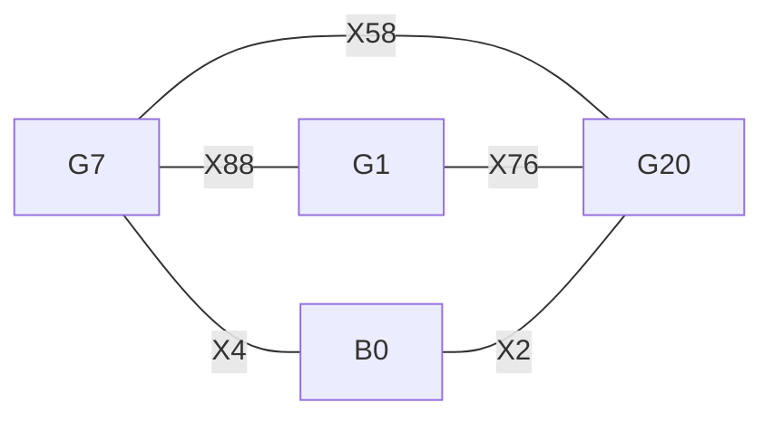

# P104 fixed-room carrier: a ten-contact ordering obstruction

**No ordering completes the fixed capture stage proposed in
[Discussion #2131](https://github.com/CrocSwap/integer-mult-bounds/discussions/2131).**
Retaining the original G captures and query caps, with monotone frame paths,
prevents the added carrier from gathering `X2 + X4` before delivery in
`R = span(32,196)`. Eight original captures and the two carrier captures already
force a contradiction. This resolves that discussion's released ordering
handoff, including orderings that start before either failed greedy prefix.

This is a **scoped proof with an exact finite certificate**, not a complete
side correction, supplier, or new κ. No solver result is trusted by the replay.
The claim is in discussion #2131. Base, sources and task refinement are recorded
in [SOURCES.json](SOURCES.json) and [TASK.json](TASK.json).

## Contract and source binding

The scientific input is PR #1972's 4,058-event witness, retained by
[PR #1991's native channel](../p104-native-channel/README.md), at SHA256
`0f541bef7f19fdeffd67157684e9f03d785f42c89973632f508fc1a0452b580e`.
Event indices below are **zero based** in its `program` array.

Frames are subspaces of the recorded binary nine-dimensional label space.
A contact requires identical canonical charts on its two registers. Between
contacts a register may move to any containing frame. Every source retains
its initial line; G helpers stay inside their prescribed positive-query cap
until their captures finish. The carrier starts in frame zero and must remain
inside R until both captures finish, because its subsequent delivery is in R.
Frame zero does **not** mean zero logical contents: all helpers may be dirty.

Original transports may be replaced and contacts freely reordered. No original
capture is removed, split, redirected through another register or replaced by
a different source form. No register is reset or given a descending frame move.
The proof uses only frame containment; scalar coefficients and logical dirt
cannot repair this contradiction. Arbitrary additional monotone work also
cannot erase the frame vectors used below.

The three inherited caps and the carrier cap are:

| Helper | Cap basis | Positive query event |
|---|---|---|
| G1 | 1, 2, 8, 16, 32, 64, 128, 256 | 1563, into Q0 |
| G7 | 1, 2, 4, 8, 16, 64, 128, 256 | 1557, into Q1 |
| G20 | 1, 2, 8, 16, 36, 64, 128, 260 | 1544, into Q5 |
| B0 | 32, 196 | delivery room R |

For a direct hand check, number bits from zero at the least significant bit.
G1's cap is `bit_2 = 0`, G7's is `bit_5 = 0`, and G20's is
`bit_2 XOR bit_5 XOR bit_8 = 0`. B0's cap is the four-element set
`{0,32,196,228}`.

The following table is the complete finite premise of the obstruction.
Among these four caps, each source label lies **exactly** in its two listed caps.
Every listed pair of helpers is different.

| Source | Initial label | Two required helpers | Capture event IDs |
|---|---:|---|---|
| X2 | 228 | G20, B0 | 1160, carrier-X2 |
| X4 | 196 | G7, B0 | 745, carrier-X4 |
| X58 | 333 | G7, G20 | 631, 1154 |
| X76 | 289 | G20, G1 | 807, 1267 |
| X88 | 458 | G1, G7 | 799, 945 |

The original coefficients, query frames and source lines are reconstructed from
the witness, not copied from a discussion summary. The added carrier coefficients
are both +1. Membership is checked by both binary row reduction and explicit
enumeration of each subspace. [CERTIFICATE.json](CERTIFICATE.json) records every
binding, count and control witness.

## Proof: five sources cannot use four first contacts

Here is the general lemma used by this instance. Suppose each source s has two
required contacts with distinct helpers, its nonzero initial label belongs to
exactly those two helper caps, and different sources use different unordered
helper pairs. Frames grow monotonically and every required contact uses a
common frame inside its helper's cap. Then the number of sources is at most
the number of helpers.

For each source s, take its **earlier** required contact, with helper h; write k
for its other helper. This must be h's first contact among the required contacts.
Otherwise h previously contacted some different source t, so its frame contains
t's initial label. At the h–s contact that label enters s's frame. Monotonicity
retains it until the later k–s contact, where it must belong to k's cap.
But t is incident to h and cannot also be incident to k: its helper pair would
then equal s's pair. The cap-membership hypothesis therefore excludes t's label
from k's cap, a contradiction.

Thus each source requires the first required contact of a helper. A helper has
only one first contact, so this assignment is injective. In the table there are
five sources and four helpers. Therefore the ten contacts cannot all occur.
Any complete 418-capture schedule would contain these ten contacts in some
order and satisfy the same monotonicity and cap conditions, so it is impossible
as well. The argument does not freeze a greedy prefix or any original climb.

In the helper graph, the sources are five different edges on four vertices:



## Independent finite corroboration and controls

For a fixed order it suffices to use the smallest possible common frame at
each contact, the sum of the two current subspaces. By induction these frames
are contained in the corresponding frames of every other monotone realization
of that order. A cap violation in the minimal realization therefore excludes
the order; a cap-respecting minimal realization supplies its frame schedule.

Two separately implemented recursions count every permutation, pruning only
an actual cap violation. One represents every frame by the bits indicating
which caps fail to contain it; these bits combine by OR under subspace sum.
The other carries the actual sets of binary vectors. They agree:

* Zero legal orders of the ten contacts: 2,921 signature states and 3,948 actual
  subspace states. The dynamic-programming recurrence accounts for all 10!
  permutations, including extensions of rejected prefixes.
* Removing any one contact admits legal orders. Counts in displayed certificate
  order are `13760,13520,14860,13520,13520,13760,13520,14860,14860,14860`.
  Each removal includes a complete nine-contact witness, replayed as actual
  subspaces. This proves deletion minimality of this ten-contact core, not a
  global minimum obstruction size or feasibility of the remaining full program.
* All 416 original captures pass in their original order with minimal-join
  paths and without the carrier. This is a capture-stage control, not a cold replay.
* Enlarging G1's cap alone to FULL, or B0's cap alone to FULL, admits 135,360
  orders in each case. These are controls on the necessary cap hypothesis,
  not legal repairs of the original contract. Each has an explicit witness.
* The proof checker rejects all ten contact omissions, both relaxed caps and
  an incorrect initial label. Order replay rejects a missing contact. Complete
  certificate comparison rejects altered coefficients, counts and JSON types;
  duplicate JSON keys are rejected. The direct command checks the source hash.

The small core was discovered with Z3 5.3.0.0. Z3 is not a package dependency,
and neither its `unsat` answer nor its core-minimization procedure is needed
to reproduce or accept the result. The written injection proof and the two
standard-library enumerations are the evidence. They are author-checked;
independent human review and a proof-assistant formalization remain open.

## Reproduce

From the repository root, with Python 3.12 and no third-party dependencies:

```sh
python3 -I -B scripts/research_package.py --package research/p104-carrier-capture-order --check-only
python3 -I -B scripts/research_package.py --package research/p104-carrier-capture-order
```

Expected verifier line (local direct replay takes less than a second):

```text
PASS_P104_CARRIER_CAPTURE_ORDER contacts=10 sources=5 helpers=4 legal_orders=0 deletion_controls=10 original_captures=416 no_new_kappa
```

The registered hook runs normal and optimized replay. Direct replay also works
without Git or network in an export containing this package and the pinned
witness at its relative path. To regenerate the certificate without overwriting
committed evidence, use `verify.py --write-certificate NEW_FILE.json`.

## Limits

This closes only the fixed `X2,X4` room component with retained G contacts and
query caps. Its proposed Y0/Y6 deliveries, scattering, restoration, native
phases, paid histogram, owners, precision and all-size admission are not
constructed or checked. The obstruction occurs before those obligations.
It establishes no added-rank tariff, favorable completed moment or κ change.
This account's [PR #2172](https://github.com/CrocSwap/integer-mult-bounds/pull/2172)
prices a different frozen-cut network; its 864-rank bound is not reused here.
The retained-transport bounds in #2082/#2090/#2113/#2127 and the refined-interval
bound in #2148 have different hypotheses.

## Open next questions

The next useful test is a different carrier rectangle or changed capture/query
contract. First search its incidence table for a subgraph satisfying this lemma;
reject it before scheduling if it has more source edges than helpers. A survivor
still needs a complete chronological dirty-restored word and a favorable full
bill. Alternatively, explicitly price a nonmonotone move or a replacement of a
required contact that breaks this core; an uncharged reset or enlarged query cap
is not an implementation. Structured questions and blockers are in TASK.json.

## Credit

Hope7Happiness's Discussion #2131 supplied the fixed room component, the changed
monotone-path contract, the two unsuccessful prefixes and the released ordering
question. This package supplies the obstruction, not that component proposal.
Rohan Arun's PR #1972 supplies the scalar/frame witness; Chafik Boukhalfa's
PR #1991 supplies the native realization and retained witness. Adam Gall's
PR #1940 supplies the schedule; Josie Elliston's PR #1071 and Ali Romman's
PR #1125 supply the fixture/reconstruction, with their retained E8 and compiler
lineage. Source files and source-specific notices remain unchanged.

Prepared for commdata2338 (@commdata2338), with substantial OpenAI Codex assistance.
Apache-2.0. No independent human review or complete multiplication theorem is claimed.
